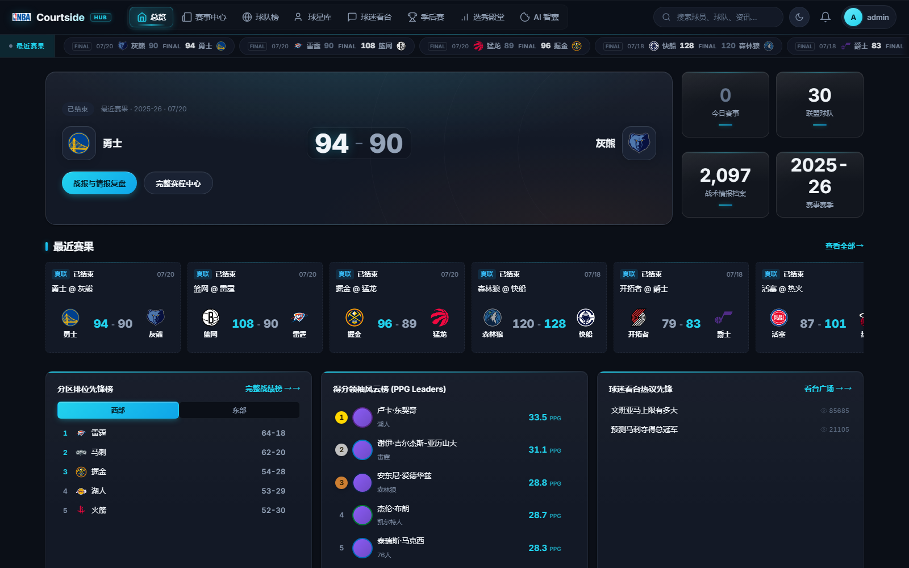
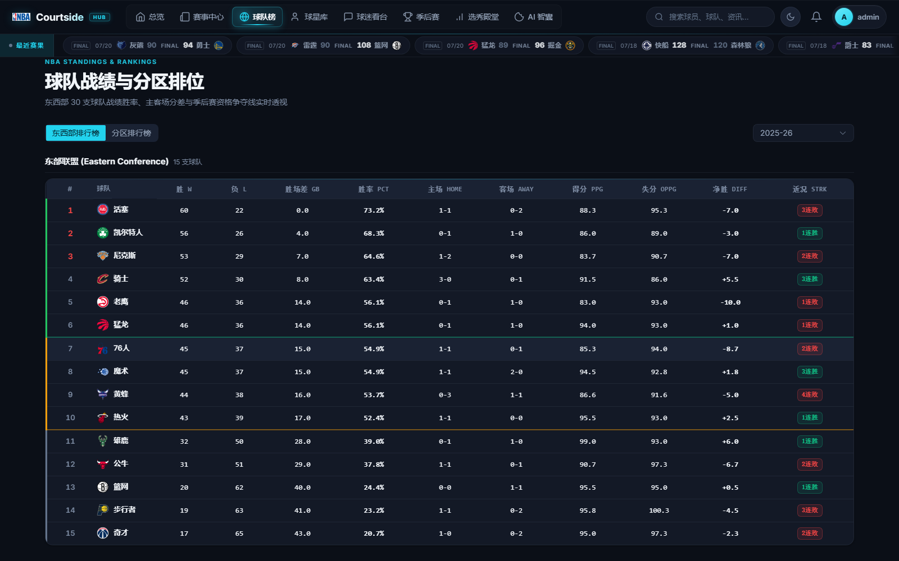
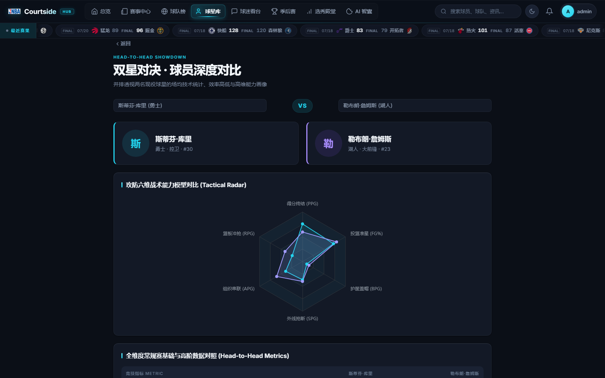
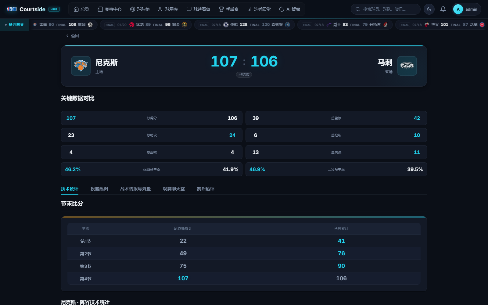
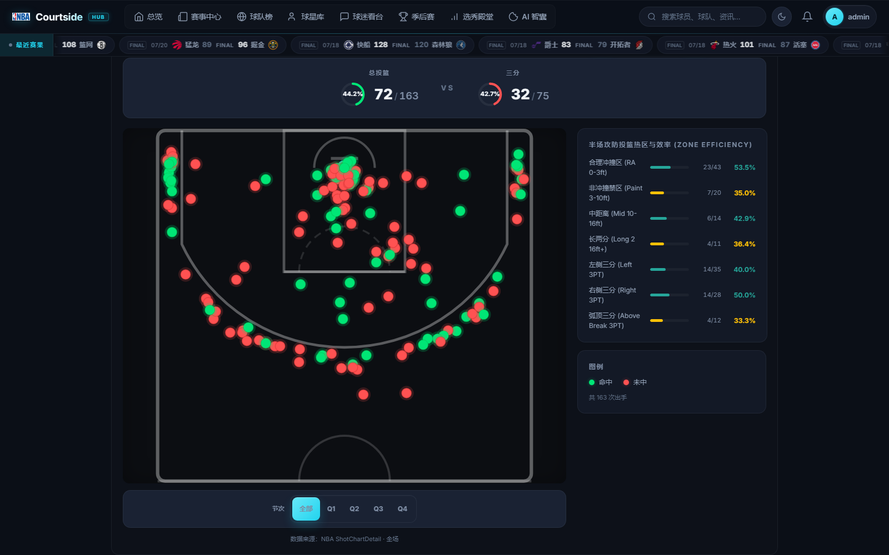
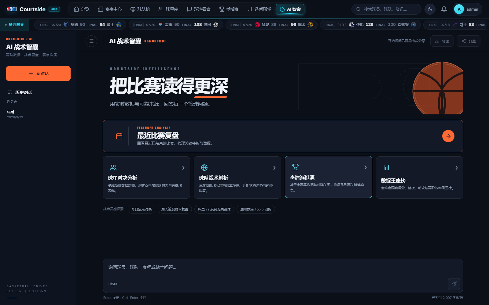
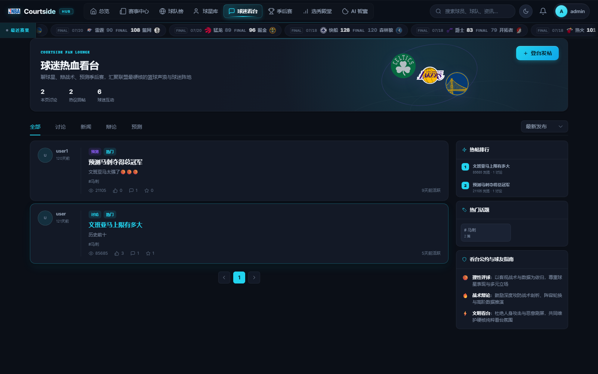
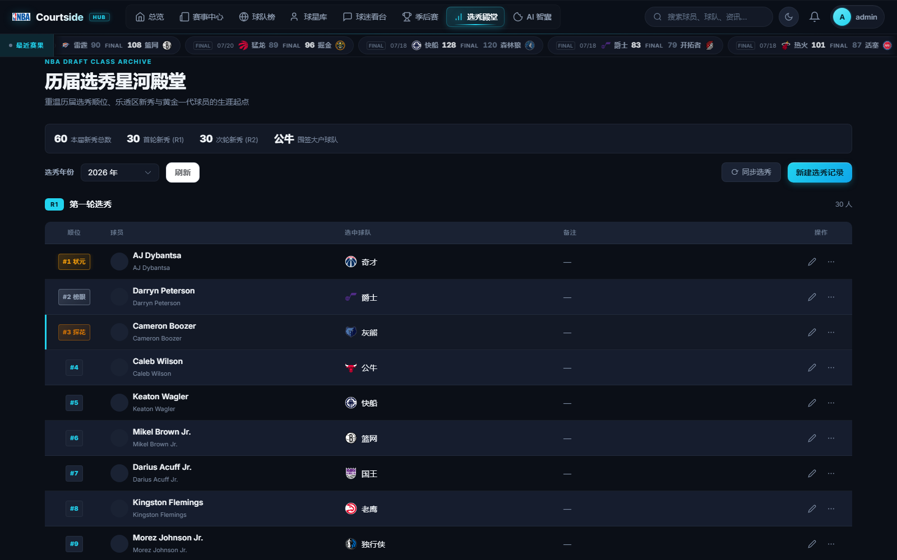
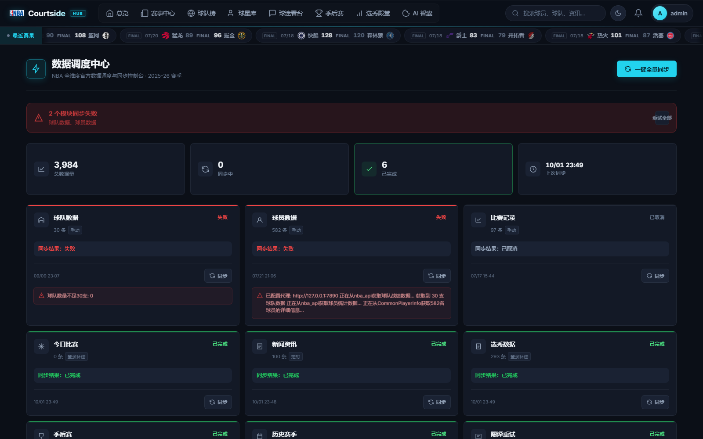
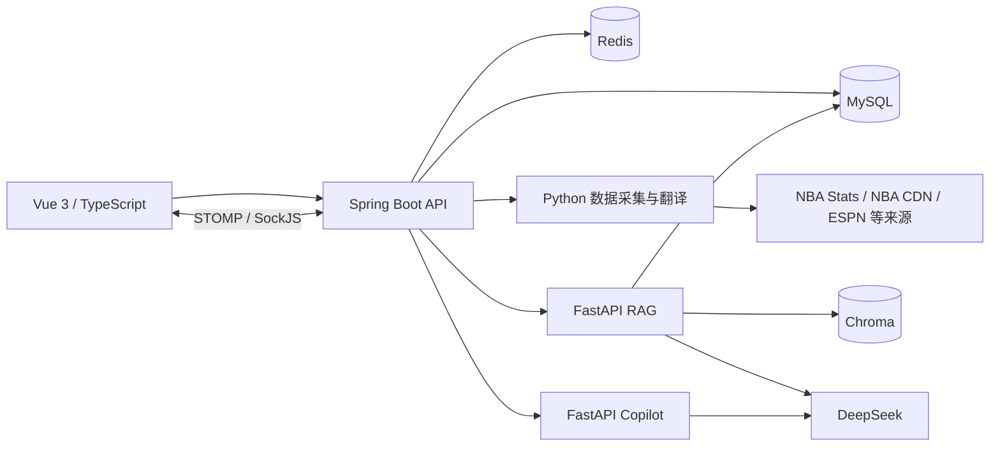

# NBAManager v4

当前版本：`4.0.0`，Git 标签：[v4](https://github.com/quanyechaTAT/NBAManager/tree/v4)。

面向 NBA 数据浏览、比赛复盘和球迷社区的全栈演示项目。使用 Spring Boot、Vue 3 和 Python，将数据采集、同步任务、可视化、实时聊天及 DeepSeek 问答整合在同一个应用中。

前端界面使用 **Courtside** 品牌。适合 NBA 数据应用实践、全栈开发学习和本地演示；普通数据与社区功能可以在未配置 DeepSeek Key 时使用，AI 回答和 LLM 翻译需要有效的模型服务配置。

## 目录

- [界面展示](#界面展示)
- [功能与页面导航](#功能与页面导航)
- [架构与技术栈](#架构与技术栈)
- [本地运行](#本地运行)
- [数据同步与首次使用](#数据同步与首次使用)
- [AI 服务与检索](#ai-服务与检索)
- [配置参考](#配置参考)
- [构建与测试](#构建与测试)
- [项目结构](#项目结构)
- [接口入口与调用示例](#接口入口与调用示例)
- [部署与使用边界](#部署与使用边界)
- [常见问题](#常见问题)
- [仓库内容与贡献](#仓库内容与贡献)
- [许可证](#许可证)

## 界面展示

以下截图来自本地运行的 v4 页面，使用深色主题；截图中的赛季、比分、榜单、选秀和社区内容是本地演示数据库的展示结果，不代表当前 NBA 官方实时数据。图片保存在 [docs/images](docs/images)，点击可查看原图。

### 赛事总览

最近赛果、赛季概览、东西部分区排名、得分榜和社区热议集中展示。

[](docs/images/dashboard.png)

### 数据浏览与比赛分析

| 球队战绩与排名 | 球员深度对比 |
| --- | --- |
| [](docs/images/teams.png) | [](docs/images/player-compare.png) |
| 东西部与分区排名、赛季筛选、主客场表现。 | 两名球员并排查看，结合雷达图与指标表分析。 |

| 比赛技术统计 | 投篮分布 |
| --- | --- |
| [](docs/images/match-detail.png) | [](docs/images/shot-chart.png) |
| 总比分、球队指标、节末累计比分和球员 Box Score。 | 结合球场分布与区域效率查看出手，按球队和命中状态筛选。 |

### AI、社区与管理

| AI 战术智囊 | 球迷看台 |
| --- | --- |
| [](docs/images/smart-search.png) | [](docs/images/community.png) |
| 问答入口、分析建议、历史对话、导出与分享。 | 分类帖子、评论互动、热帖与话题聚合。 |

| 历届选秀 | 管理员数据调度 |
| --- | --- |
| [](docs/images/draft.png) | [](docs/images/admin-sync.png) |
| 按年份查看轮次、顺位、球员与所属球队。 | 展示完成、失败、取消状态和错误摘要；失败任务可重试。 |

## 功能与页面导航

| 模块 | 已有能力 |
| --- | --- |
| 数据看板 | 球队排名、球员榜单、今日比赛、赛季概览 |
| 球队与球员 | 球队详情、球员资料、赛季与生涯数据、球员对比、收藏和导出 |
| 比赛与复盘 | Box Score、逐节比分、Play-by-Play、投篮图、走势、精彩瞬间和转折点 |
| AI 分析 | 比赛总结、事件解释、事实校验、带来源的 RAG 流式问答 |
| NBA Copilot | 问题意图分类，路由到 Replay、Stats 或 General 处理器 |
| 资讯与赛事 | 新闻聚合与翻译、季后赛对阵、选秀、历史赛季查询 |
| 球迷社区 | 帖子、评论、回复、点赞、投票、通知及比赛聊天室 |
| 个人中心 | 注册登录、头像和资料管理、关注、收藏、浏览历史 |
| 管理后台 | 模块与全量同步、任务进度、取消、历史记录、自动调度和登录补偿 |

RAG 使用结构化查询、Chroma 向量检索、CrossEncoder 重排和网络来源补充，并在证据不足时限制回答。Copilot 当前使用 Python 意图路由；Stats 处理器仍主要依赖模型知识，查询实时统计时应优先使用数据页面或 RAG。AI 输出的准确性受数据完整度和外部服务可用性影响。

### 页面导航

前端使用 Hash 路由，例如 `http://localhost:5173/#/dashboard`。除登录、注册与公开分享入口外，页面需要登录；管理员页面还需要 `ADMIN` 角色。

| 页面 | 路径 | 主要操作 |
| --- | --- | --- |
| 总览 / 赛事中心 | `/dashboard`、`/news` | 浏览最近赛果、赛程、新闻与榜单 |
| 球队 / 球员 | `/teams`、`/players` | 筛选、打开档案、收藏和导出 |
| 双星对决 | `/players/compare` | 选择两名球员并查看雷达图与指标表 |
| 比赛详情 | `/match-detail` | 技术统计、投篮图、复盘、聊天与赛后评论 |
| 球迷看台 | `/community`、`/community/post` | 发帖、讨论、点赞与投票 |
| 季后赛 / 选秀 / 历史 | `/playoff`、`/drafts`、`/history` | 查询不同赛季与年份 |
| AI 战术智囊 | `/smart-search` | 提问、查看历史、导出或分享对话 |
| 我的主场 | `/profile` | 管理头像、用户名、密码、关注与收藏 |
| 数据调度中心 | `/admin/sync` | 查看模块与任务详情，提交同步或取消任务 |

详情页应从对应列表进入，获取正确的查询参数。比赛详情使用 `gameId`；球员对比可通过 `id1`、`id2` 预选业务数据库中的球员 ID。

## 架构与技术栈



| 层级 | 主要技术 |
| --- | --- |
| 前端 | Vue 3、TypeScript、Vite 5、Element Plus、Pinia、Vue Router、Axios |
| 可视化与通信 | ECharts、vue-echarts、STOMP.js、SockJS |
| Java 后端 | Java 17、Spring Boot 3.2.5、Spring Security、JWT、JPA、Flyway |
| 存储 | MySQL、Redis、ChromaDB |
| Python 服务 | Python 3.12、nba_api、FastAPI、Uvicorn、sentence-transformers、PyTorch |
| 测试 | JUnit / Mockito、Vitest / Vue Test Utils、vue-tsc、Pytest |

## 本地运行

以下命令从项目根目录开始。准备 Java 17、Node.js 18.x 或 20+、Python 3.12、MySQL 8 和 Redis 6+；Maven 由仓库中的 Wrapper 提供。先确认 `java -version`、`node --version`、`python --version`，避免虚拟环境或 `JAVA_HOME` 指向其他版本。

默认数据库为 `localhost:3306/nba_manager`，Redis 为 `localhost:6379`。MySQL 账户需要相应的建表与更新表结构权限。模型默认在 CPU 上运行；GPU 加速可按本机 PyTorch 环境启用。

### 1. 克隆与配置

```bash
git clone https://github.com/quanyechaTAT/NBAManager.git
cd NBAManager
```

PowerShell：

```powershell
Copy-Item .env.example .env
python -c "import secrets; print(secrets.token_hex(32))"
```

macOS / Linux：

```bash
cp .env.example .env
python3 -c "import secrets; print(secrets.token_hex(32))"
```

将生成的随机值填入 `JWT_SECRET`，再填写数据库密码；使用 AI 功能时配置自己的 `DEEPSEEK_API_KEY`。完整配置见 [.env.example](.env.example)。

| 配置 | 用途 |
| --- | --- |
| `DB_USERNAME`、`DB_PASSWORD` | Java 与 Python 的数据库凭据 |
| `DB_HOST`、`DB_PORT`、`DB_NAME` | Python 数据库连接；Java 改用其他数据库地址时，还需配置 `SPRING_DATASOURCE_URL` |
| `REDIS_HOST`、`REDIS_PORT`、`REDIS_PASSWORD` | Redis 连接 |
| `JWT_SECRET` | 自行生成的登录签名密钥，至少 32 字节 |
| `DEEPSEEK_API_KEY`、`DEEPSEEK_API_BASE` | AI 回答、解释与 LLM 翻译 |
| `DEEPSEEK_MODEL`、`RAG_LLM_MODEL` | Java/Copilot 与 RAG 的模型配置 |
| `PYTHON_EXECUTABLE` | 采集与翻译脚本使用的可选 Python 绝对路径；AI 常驻服务优先查找 `backend/scripts/venv312` |
| `NBA_PROXY_HOST`、`NBA_PROXY_PORT` | 可选的数据采集代理 |
| `ADMIN_USER`、`ADMIN_PASS` | 新闻维护及性能测量脚本的登录账号，需事先自行创建 |

### 2. 安装依赖

PowerShell：

```powershell
python -m venv backend/scripts/venv312
.\backend\scripts\venv312\Scripts\python.exe -m pip install -r backend/scripts/requirements-dev.txt
Push-Location frontend
npm ci
Pop-Location
```

macOS / Linux：

```bash
python3 -m venv backend/scripts/venv312
backend/scripts/venv312/bin/python -m pip install -r backend/scripts/requirements-dev.txt
cd frontend
npm ci
cd ..
```

`requirements-dev.txt` 同时安装运行与测试依赖。只运行服务时可以改为 `requirements.txt`。RAG 首次启动会下载向量和重排模型，模型与向量索引保存在本地忽略目录中。

### 3. 将配置加载到当前终端

Java 的 `EnvFileReader` 为部分业务代码读取 `.env`，但 Spring 配置占位符还需要系统环境变量。因此，启动后端或手动启动 Python 服务前，需要在**每个相关终端的项目根目录**加载配置。

PowerShell：

```powershell
Get-Content -LiteralPath .env | ForEach-Object {
    if ($_ -match '^\s*([A-Za-z_][A-Za-z0-9_]*)\s*=(.*)$') {
        $configName = $Matches[1]
        $configValue = $Matches[2].Trim().Trim('"').Trim("'")
        [Environment]::SetEnvironmentVariable($configName, $configValue, 'Process')
    }
}
```

macOS / Linux：

```bash
set -a
. ./.env
set +a
```

### 4. 首次初始化空数据库

先确保 MySQL 与 Redis 已启动。可在 MySQL 客户端或数据库管理工具中创建业务库：

```sql
CREATE DATABASE IF NOT EXISTS nba_manager
    CHARACTER SET utf8mb4 COLLATE utf8mb4_unicode_ci;
```

当前基础业务表由 JPA 的 `ddl-auto: update` 建立，部分 Flyway 增量脚本依赖这些表已经存在。**全新空库**需要先禁用 Flyway 启动一次，待应用完成启动、基础表建立后按 `Ctrl+C` 退出：

PowerShell：

```powershell
cd backend
.\mvnw.cmd spring-boot:run "-Dspring-boot.run.arguments=--spring.flyway.enabled=false"
```

macOS / Linux：

```bash
cd backend
./mvnw spring-boot:run -Dspring-boot.run.arguments=--spring.flyway.enabled=false
```

已有完整业务表的数据库跳过此步。随后使用下面的正常启动命令，让 Flyway 建立基线并应用增量；不需要手工执行 `db/legacy/` 下的归档 SQL。

### 5. 启动后端与前端

后端终端（已加载环境变量）：

```powershell
# 从项目根目录进入 backend
cd backend
.\mvnw.cmd spring-boot:run
```

macOS / Linux 将 `.\mvnw.cmd` 换为 `./mvnw`。另开终端启动前端：

```bash
cd frontend
npm run dev
```

Java 会尝试启动本机的 RAG 与 Copilot 子进程，无需重复启动。如果要单独调试 Python 服务，在加载配置后执行：

```powershell
# RAG：在项目根目录执行
Push-Location backend/scripts
.\venv312\Scripts\python.exe -m rag_app.main 18999
Pop-Location

# Copilot：在另一终端的项目根目录执行
Push-Location backend/scripts/nba_copilot_app
..\venv312\Scripts\python.exe main.py
Pop-Location
```

macOS / Linux 使用对应的 `venv312/bin/python` 路径。独立启动时 Copilot 读取 `NBA_COPILOT_PORT`；模板已配置为 `18998`。

| 服务 | 默认访问地址 |
| --- | --- |
| 前端 | [http://localhost:5173](http://localhost:5173) |
| 后端 API | [http://localhost:8080/api/teams](http://localhost:8080/api/teams) |
| RAG 健康检查 | [http://127.0.0.1:18999/health](http://127.0.0.1:18999/health)，模型就绪 `200`、加载中可能 `503` |
| Copilot 健康检查 | [http://127.0.0.1:18998/health](http://127.0.0.1:18998/health) |

### 6. 创建管理员与同步数据

应用当前没有自动创建管理员账号的初始化逻辑。先在前端注册自己的账号，再由数据库管理员将这个**指定账号**提升为管理员：

```sql
USE nba_manager;
UPDATE user_accounts SET role = 'ADMIN' WHERE username = 'your_admin_username';
```

替换为刚注册的用户名，并重新登录；若旧身份缓存尚未过期，稍等或重启后端。进入数据管理中心后，可触发球队、球员、比赛、新闻等模块的同步。新环境的数据完整度取决于首次同步结果，外部接口限流或网络失败时可查看任务详情并重试。

## 数据同步与首次使用

Git 仓库不包含业务数据库，截图中的数据不会随克隆自动导入。新库建表并创建管理员后，可执行全量同步，或先同步球队、球员，再同步比赛和其他模块。全量同步按以下顺序执行；历史数据和翻译通常耗时更长。

| 顺序 | 模块标识 | 数据内容 | 默认自动调度 |
| --- | --- | --- | --- |
| 1 | `TEAMS` | 球队资料与战绩 | 全量同步时执行 |
| 2 | `PLAYERS` | 球员档案与统计 | 全量同步时执行 |
| 3 | `MATCHES` | 比赛记录 | 全量同步时执行 |
| 4 | `TODAY_GAMES` | 今日赛程与赛况 | 每 5 分钟 |
| 5 | `NEWS` | 新闻资讯 | 每小时 |
| 6 | `DRAFT` | 选秀数据 | 每日 04:20；6 月 15–30 日与 7 月 1–10 日每半小时 |
| 7 | `PLAYOFF` | 季后赛对阵 | 4–6 月每 2 小时 |
| 8 | `HISTORICAL` | 历史赛季数据 | 每日 04:00 |
| 9 | `TRANSLATION` | 中文翻译与补全 | 每小时第 10 分钟 |

每日 **03:00** 另有全量同步，默认时区为 `Asia/Shanghai`。管理员登录时会检查遗漏的模块调度并提交补偿任务；应用需持续运行，定时任务才会正常触发。调度实现见 [DataSyncScheduler](backend/src/main/java/com/nbamanager/service/DataSyncScheduler.java) 和 [SyncDefinitionRegistry](backend/src/main/java/com/nbamanager/service/SyncDefinitionRegistry.java)。

后台可以查看数据数量、最近同步时间、任务步骤、进度和错误摘要。状态包括 `QUEUED`、`RUNNING`、`CANCELLING`，以及 `SUCCESS`、`PARTIAL_FAILED`、`FAILED`、`CANCELLED`、`INTERRUPTED` 等结束状态。

相同模块的活动任务可能被复用；全量任务与模块任务冲突时会拒绝新的提交。取消请求可能先进入 `CANCELLING`，等待当前工作步骤释放资源后才完成。遇到来源限流、代理不可用或 Python 超时，先查看失败步骤，修复环境后重试对应模块。

首次体验可按“注册登录 → 同步球队/球员/比赛 → 浏览详情与对比 → 配置 AI → 准备复盘或建立索引”的顺序验证。休赛期“今日暂无赛事”属于正常数据状态，仍可浏览历史赛果。

## AI 服务与检索

RAG 结合结构化数据查询、向量检索、重排和网络证据补充；比赛复盘根据已有逐回合数据展示走势与关键事件，并区分完整、部分和缺失的数据状态。Copilot 当前是 Python 意图路由，未接入 LangGraph 执行图；Stats 处理器主要依赖模型知识，实际赛季统计仍应结合数据页面核对。

RAG 向前端提供 SSE 渐进显示。当前 Java 的 `/api/rag/stream` 会等待 Python 非流式查询结果，再合成分片事件，因此首段内容的等待时间包含检索与模型生成时间。

### 模型与索引

默认向量模型为 `richinfoai/ritrieve_zh_v1`，重排模型为 `BAAI/bge-reranker-v2-m3`，默认使用 CPU。首次启动需要下载模型；缓存与 Chroma 索引默认位于 `backend/scripts/runtime/rag/`，并兼容旧的 `models/`、`chroma_db/` 目录。

数据库同步与向量索引更新是不同步骤。同步完成后若检索文档为空或内容落后，可由管理员调用 `POST /api/rag/rebuild`。接口返回后台启动状态，完成后查看 `GET /api/rag/stats` 的文档数量，避免并发重复重建。

`DEEPSEEK_MODEL` 和 `RAG_LLM_MODEL` 是模型名配置，模板使用 `deepseek-v4-flash`；请按自己 API 账户支持的模型修改。健康检查通过表示服务就绪，模型调用还需要有效 Key、可用模型与外部网络。

### 独立调试与日志

Windows 的独立启动命令见上文。macOS / Linux 可在已加载 `.env` 的两个终端中分别执行：

```bash
# RAG：从项目根目录执行
cd backend/scripts
./venv312/bin/python -m rag_app.main 18999
```

```bash
# Copilot：从项目根目录执行
cd backend/scripts/nba_copilot_app
../venv312/bin/python main.py
```

自动拉起的日志位于 `backend/scripts/rag_app.log` 和 `backend/scripts/nba_copilot_app/copilot.log`。Java 启动器优先查找 `backend/scripts/venv312`；`PYTHON_EXECUTABLE` 主要用于采集/翻译脚本，不应作为 AI 启动器的统一覆盖参数。

## 配置参考

基础连接、凭据与服务地址见 [本地运行](#本地运行) 和 [.env.example](.env.example)。以下列出检索、超时与部署参数，默认/模板值以当前配置为准；部分运维参数可按需追加到 `.env`。Java 的完整配置见 [application.yml](backend/src/main/resources/application.yml)，RAG 见 [config.py](backend/scripts/rag_app/config.py)。

| 参数 | 默认/模板值 | 用途 |
| --- | --- | --- |
| `RAG_SERVER_URL` | `http://127.0.0.1:18999` | Java 连接 RAG |
| `COPILOT_BASE_URL` | `http://127.0.0.1:18998/api/nba-copilot` | Java 连接 Copilot，保留 API 路径 |
| `RAG_PORT`、`NBA_COPILOT_PORT` | `18999`、`18998` | 手动启动 Python 服务的端口 |
| `NBA_MANAGER_API` | `http://127.0.0.1:8080` | Python 调用 Java 的根地址 |
| `RAG_SEARCH_ENABLED` | `true` | 是否补充网络证据 |
| `RAG_SEARCH_PROVIDERS` | `espn_scoreboard,espn_news,google_news_rss` | 联网检索来源 |
| `RAG_SEARCH_TIMEOUT_SECONDS`、`RAG_SEARCH_TOP_K` | `8`、`5` | 联网检索超时和结果数量 |
| `RAG_SEARCH_CACHE_TTL_SECONDS` | `600` | 联网结果缓存时间 |
| `RAG_ALLOW_GENERAL_WEB_SEARCH` | `false` | 通用网页检索，可选 `RAG_SEARXNG_BASE_URL` |
| `RAG_MAX_VECTOR_DISTANCE`、`RAG_MIN_RERANK_SCORE` | `0.68`、`0` | 向量距离与重排证据阈值 |
| `RAG_FORCE_WEB_SEARCH` | `false` | 是否强制补充联网检索 |
| `RAG_EMBEDDING_MODEL`、`RAG_RERANKER_MODEL` | 上文列出的模型 | 可选的向量/重排模型覆盖 |
| `RAG_AUTO_DETECT_DEVICE` | `false` | 自动设备检测，先安装匹配的 PyTorch 环境 |
| `RAG_EMBEDDING_DEVICE`、`RAG_RERANKER_DEVICE` | 未指定时默认 CPU | 可选显式设备，如 `cpu`、`cuda` |
| `RAG_LLM_TIMEOUT_SECONDS` | `300` | 模板中的模型调用超时 |
| `RAG_CONNECT_TIMEOUT_MS`、`RAG_READ_TIMEOUT_MS` | `10000`、`600000` | Java 连接/读取 RAG 的超时 |
| `RAG_ASYNC_TIMEOUT_MS` | `600000` | Spring 异步请求超时 |
| `VITE_RAG_STREAM_IDLE_TIMEOUT_MS` | `300000` | 前端 SSE 空闲超时 |
| `CORS_ALLOWED_ORIGINS`、`WS_ALLOWED_ORIGINS` | 本地开发 Origin 等 | 部署时改为实际前端域名 |
| `TRUSTED_PROXY_IPS` | 空 | 接受转发客户端 IP 的可信代理列表 |
| `SYNC_CRON_FULL`、`SYNC_ZONE` | `0 0 3 * * ?`、`Asia/Shanghai` | 全量同步计划和时区 |
| `CHAT_CLEANUP_ENABLED`、`CHAT_RETENTION_DAYS` | `true`、`180` | 聊天记录清理与保留天数 |
| `HIKARI_MAX_POOL`、`HIKARI_MIN_IDLE` | `20`、`5` | MySQL 连接池大小 |
| `TOMCAT_MAX_THREADS`、`TOMCAT_MAX_CONNECTIONS` | `200`、`2000` | Web 工作线程与连接上限 |
| `BULKHEAD_GLOBAL_MAX`、`BULKHEAD_PER_CLIENT_MAX` | `180`、`100` | 全局与单客户端在途请求限制 |
| `HTTP_MAX_REQUEST_MILLIS`、`HTTP_LONG_REQUEST_MILLIS` | `30000`、`120000` | 普通与长请求的处理时长限制 |

项目根目录 `.env` 不会被 Vite 自动作为 `frontend/.env` 加载。覆盖 `VITE_*` 参数时，应在前端启动/构建终端也加载根目录配置，再重启开发服务器或重新构建；不要将凭据放入 `VITE_*` 变量。Linux 加载时，Cron 等含空格或 shell 特殊字符的值需要正确加引号。

调整并发参数时应同时考虑连接池、Web 线程和 Python 服务资源；全局在途上限应低于 Tomcat 工作线程数并留出拒绝响应所需的余量。性能容量应在目标部署环境测量。

## 构建与测试

### 测试

| 检查 | Windows 命令与目录 |
| --- | --- |
| Java 单元测试 | `cd backend` 后执行 `.\mvnw.cmd test` |
| Python 测试 | 在根目录执行 `.\backend\scripts\venv312\Scripts\python.exe -B -m pytest backend/scripts/tests -q -p no:cacheprovider` |
| 前端测试 | `cd frontend` 后执行 `npm test` |
| 前端类型检查 | `cd frontend` 后执行 `npm run typecheck` |
| 前端构建 | `cd frontend` 后执行 `npm run build` |

macOS / Linux 使用 `./mvnw` 和 `venv312/bin/python`。默认 Maven 测试排除 `ChatCleanupIntegrationTest`。集成测试会创建随机命名的隔离测试库，并以 JPA `create-drop` 管理测试表；配置独立的 MySQL 与 Redis 连接，确保 MySQL 账户具备建库/建表权限。可设置 `TEST_DB_HOST`、`TEST_DB_PORT`、`TEST_DB_USERNAME`、`TEST_DB_PASSWORD`、`TEST_REDIS_HOST`、`TEST_REDIS_PORT` 后执行：

```powershell
cd backend
.\mvnw.cmd -Pintegration-test test
```

该 Profile 只选择上述集成测试，不能代替默认单元测试。配置见 [application-test.yml](backend/src/test/resources/application-test.yml)，避免使用业务数据库作为测试环境。

### 单个 Java 应用打包

前端源码位于 `frontend/`；`backend/src/main/resources/static/` 是可重新生成的前端部署产物，不纳入版本控制。需要由 Spring Boot 同时提供页面与 API 时，先构建前端再打包后端：

```powershell
# 从项目根目录执行；这会重新生成后端的 static 部署目录
Push-Location frontend
npm run build -- --outDir ../backend/src/main/resources/static --emptyOutDir
Pop-Location
Push-Location backend
.\mvnw.cmd clean package
java -jar target/nba-manager-backend-4.0.0.jar
Pop-Location
```

运行 JAR 的终端也需事先加载环境变量。Python 脚本、虚拟环境、MySQL 和 Redis 仍需部署在应用可访问的位置；Java JAR 不包含 Python 运行环境。也可以独立部署 `frontend/dist/`，由反向代理连接 Java API、上传资源和 WebSocket。

macOS / Linux 的同等打包命令：

```bash
cd frontend
npm run build -- --outDir ../backend/src/main/resources/static --emptyOutDir
cd ../backend
./mvnw clean package
java -jar target/nba-manager-backend-4.0.0.jar
```

打包后可访问 `http://localhost:8080`。单独执行 Maven 不会自动构建前端；部署时保留 `backend/scripts/` 和对应虚拟环境，从 `backend/` 启动 Java，让子进程能找到脚本与模型。

## 项目结构

```text
NBAManager/
├── backend/
│   ├── .mvn/、mvnw、mvnw.cmd       # Maven Wrapper
│   ├── pom.xml
│   ├── src/main/java/com/nbamanager/
│   │   ├── config/、security/       # 配置、认证与权限
│   │   ├── domain/、repository/     # 数据模型与持久化
│   │   ├── service/                 # 同步、复盘、社区与 AI 服务
│   │   └── web/                     # REST / WebSocket 接口及 DTO
│   ├── src/main/resources/
│   │   ├── application.yml
│   │   └── db/                      # migration 增量脚本与 legacy 归档
│   ├── src/test/                    # Java 测试
│   └── scripts/
│       ├── nba_data_fetcher.py
│       ├── translator.py
│       ├── rag_app/                 # 检索、结构化查询、索引与流式 API
│       ├── nba_copilot_app/          # 意图分类与处理器
│       ├── tests/
│       └── requirements*.txt
├── frontend/
│   ├── public/                      # 原始图片、图标与 Service Worker
│   ├── src/                         # 页面、组件、API、状态和测试
│   └── package.json、package-lock.json
├── docs/images/                      # README 的正式页面截图
├── .env.example
├── .gitignore
├── LICENSE
└── README.md
```

## 接口入口与调用示例

完整行为以 [Java Controller 源码](backend/src/main/java/com/nbamanager/web) 为准。需要登录的请求使用 `Authorization: Bearer <token>`，管理接口需要 `ADMIN` 角色。

| 功能 | 接口示例 |
| --- | --- |
| 登录与注册 | `POST /api/auth/login`、`POST /api/auth/register` |
| 球队与球员 | `GET /api/teams`、`GET /api/players` |
| 比赛详情 | `GET /api/match-detail/{gameId}/boxscore` |
| 复盘准备与读取 | `POST /api/ai-replay/games/{gameId}/prepare`、`GET /api/ai-replay/games/{gameId}/bootstrap` |
| AI 比赛总结 | `POST /api/ai-replay/games/{gameId}/summary` |
| 投篮分布 | `GET /api/shot-chart/player/{playerId}`、`GET /api/shot-chart/game/{gameId}` |
| RAG | `GET /api/rag/stream`、`GET /api/rag/stats` |
| Copilot | `POST /api/nba-copilot/chat` |
| 新闻与社区 | `GET /api/news`、`GET /api/posts` |
| 同步后台 | `POST /api/admin/sync/{module}`、`GET /api/admin/jobs`、`GET /api/admin/overview` |

比赛接口的 `gameId` 是比赛来源 ID，球员 `id` 通常是业务数据库 ID，不要混用。列表分页通常从 `page=0` 开始，服务端会限制页码和每页数量；球员搜索示例为 `GET /api/players?q=库里&page=0&size=20`，对比为 `GET /api/players/compare?id1={id1}&id2={id2}`。

球队、球员、比赛、新闻等数据 GET API 公开可读；RAG 查询、统计、会话和 Copilot 需要登录，RAG 分享读取例外。索引重建与数据同步需要 `ADMIN`。实际权限以 [SecurityConfig](backend/src/main/java/com/nbamanager/config/SecurityConfig.java) 和 Controller 注解为准。

PowerShell 登录并查询管理概览示例：先加载 `.env`，且 `ADMIN_USER`、`ADMIN_PASS` 对应自行创建的管理员。该示例只在内存中使用 Token，不打印 Token。

```powershell
$loginBody = @{
    username = $env:ADMIN_USER
    password = $env:ADMIN_PASS
} | ConvertTo-Json
$loginResult = Invoke-RestMethod -Method Post `
    -Uri 'http://localhost:8080/api/auth/login' `
    -ContentType 'application/json' -Body $loginBody
$requestHeaders = @{ Authorization = "Bearer $($loginResult.token)" }
Invoke-RestMethod -Uri 'http://localhost:8080/api/admin/overview' `
    -Headers $requestHeaders
```

RAG SSE 使用带认证头的 `GET /api/rag/stream?question=...`，问题参数需要 URL 编码。Copilot 的 `POST /api/nba-copilot/chat` 请求体示例：

```json
{
  "message": "分析最近一场比赛的关键转折"
}
```

全量同步入口为 `POST /api/admin/sync/full`，取消任务为 `POST /api/admin/jobs/{jobId}/cancel`。新任务通常返回 `202`，复用活动任务返回 `200`；`409` 表示任务冲突。WebSocket 入口为 `/ws`，采用 SockJS + STOMP，相关实现见 [WebSocketConfig](backend/src/main/java/com/nbamanager/config/WebSocketConfig.java) 和 [聊天室组件](frontend/src/components/game-chat)。

## 部署与使用边界

### 独立前端与反向代理

在 `frontend/` 执行 `npm run build` 生成 `frontend/dist/`，由静态服务器提供页面；Java 单独打包运行。生产静态服务不会继承 Vite 开发代理，需要配置同域反向代理：

| 路径 | 上游与要求 |
| --- | --- |
| `/`、`/assets/`、`/images/` | 提供 `frontend/dist/` 中的静态文件 |
| `/api/` | 转发 Java `8080`，保留 `Authorization` 请求头 |
| `/uploads/` | 转发 Java 的上传资源入口 |
| `/ws`、`/ws/` | 转发 Java SockJS/WebSocket，支持 HTTP/1.1 和 Upgrade |
| `/api/rag/stream` | 转发 Java SSE，关闭响应缓冲并设置足够长的读取超时 |

Hash 路由的 `#` 后片段不会发送给服务器。生产环境使用 HTTPS；RAG 与 Copilot 默认只绑定本机回环，跨主机部署需另行配置受控的内部连接。

### 数据持久化与运行条件

MySQL 业务库、`backend/uploads/`、Python 的 `runtime/`、模型与 Chroma 索引都位于 Git 管理范围之外。升级或迁移时保留需要的数据，安排数据库与用户上传文件备份；模型和索引可以重新生成。

WebSocket 当前使用 Spring 内存简单消息代理，扩容为多个 Java 实例时，还需要处理跨实例消息和连接路由。

- Python AI 服务默认绑定 `127.0.0.1`，外部请求经 Java 认证入口访问。跨主机部署时，需要另行配置网络访问控制。
- 按实际域名设置 `CORS_ALLOWED_ORIGINS`、`WS_ALLOWED_ORIGINS`；只有确实使用可信代理时才设置 `TRUSTED_PROXY_IPS`。
- 配置独立的数据库密码、JWT 密钥和 API Key，限制数据库权限，并为数据库、上传文件和运行数据安排备份。
- 当前使用 JPA 自动更新基础表加 Flyway 增量迁移，生产环境应先验证数据库变更；空库初始化方式见上文。
- RAG 首次加载模型或重建索引可能较慢；模型就绪前的健康检查和回答会受影响。
- 外部数据并不保证完整或实时，AI 功能依赖可用的 API Key、模型与来源证据。
- 当前配置仅在 Java 侧压缩静态文本资源；API JSON 压缩可由网关处理。性能上限应在目标部署环境重新测量，工具位于 `backend/scripts/measure_gzip*.py`；运行这些工具前配置自己的 `ADMIN_USER` 和 `ADMIN_PASS`。

## 常见问题

| 现象 | 检查与处理 |
| --- | --- |
| 数据库连接或认证失败 | 确认 MySQL 服务、账号权限、密码；在当前终端重新加载 `.env`；非默认地址还要配置 `SPRING_DATASOURCE_URL` |
| 新库 Flyway 提示业务表不存在 | 按初始化步骤先禁用 Flyway 启动一次建立基础表，再恢复正常启动 |
| 修改 `.env` 后行为未变化 | 配置在进程启动时读取，重新加载变量并重启相应 Java/Python/Vite 进程 |
| 页面可打开但 API 失败 | 确认 Java 在 `8080` 运行；独立部署需代理 `/api`，Vite 代理只对开发服务器生效 |
| 球队、球员、比赛列表为空 | 仓库不包含业务数据库，进入管理中心同步并查看任务结果 |
| 今日赛事为 0 或资讯图片缺失 | 可能处于休赛期或外部来源暂不可用，查看已同步的历史赛果与任务日志 |
| 注册后没有管理入口 | 注册角色为 `USER`；提升指定账号为 `ADMIN` 后重新登录，等待旧身份缓存失效 |
| 重启后需要重新登录 | Token 过期、密钥改变或账号身份变化都会要求重新认证；设置稳定的随机 `JWT_SECRET` |
| RAG 健康检查返回 `503` | 向量/重排模型仍在加载，检查下载网络和 `rag_app.log`；就绪后应返回 `200` |
| AI 页面可打开但回答失败 | 检查 Python 服务、API Key、可用模型、网络与超时配置 |
| 数据页有内容但检索证据不足 | 检查 `/api/rag/stats` 文档数量；数据库同步完成后按需重建向量索引 |
| AI 首段内容等待较久 | Java 当前在 Python 查询完成后分片，CPU 检索与模型生成都可能增加等待时间 |
| Python 启动失败或找不到依赖 | 检查 `backend/scripts/venv312` 和依赖；从 `backend/` 启动 Java，或手动启动 Python 服务 |
| 聊天连接失败 | 检查登录状态、`/ws` 代理和 Upgrade、`WS_ALLOWED_ORIGINS` 与实际页面 Origin |
| 同步返回 `409` 或处于取消中 | 查看活动任务；全量与模块任务可能冲突，取消需等待当前步骤释放资源 |
| 请求返回 `429` | 可能命中登录/接口限流、并发隔离或 Python 查询容量限制，减少并发并按响应提示重试 |

## 仓库内容与贡献

提交源码、正式测试、数据库迁移、依赖清单、锁文件、配置模板及 `docs/images/` 的正式文档截图。以下内容由 [.gitignore](.gitignore) 排除：真实环境配置、用户上传文件、模型和向量库、虚拟环境、依赖目录、编译产物、日志、个人 IDE 配置及本机测试证据。

`frontend/public/` 中的源资源和 Maven Wrapper JAR 需要保留。忽略规则不会移除历史提交中的内容；如果凭据曾经提交过，需要先更换相关凭据。

更新截图时使用有数据的页面，等待加载与提示消息结束，保持清晰可读，并检查用户名、对话和图片中是否包含不应公开的信息。不要用 `git add -f` 强行添加 `.env`、本地配置或运行数据。

欢迎通过 Issue 描述问题或提出建议。提交 Pull Request 时说明改动目的与验证结果，并运行与改动相关的 Java、Python 或前端检查。提交前可用以下命令检查变更范围：

```bash
git status --short
git diff --check
git diff --cached --stat
```

## 许可证

项目代码采用 [MIT License](LICENSE)。第三方数据、图片和服务的使用需遵守各自的条款。
