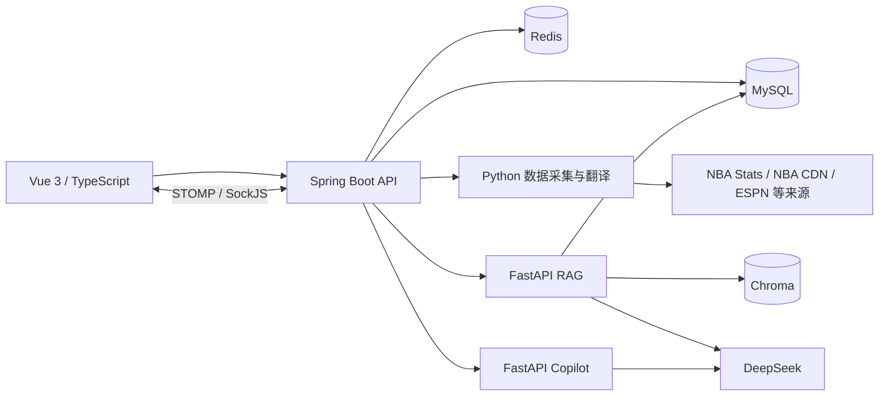

# NBAManager v4

当前版本：`4.0.0`，Git 标签：`v4`。

面向 NBA 数据浏览、比赛复盘和球迷社区的全栈演示项目。使用 Spring Boot、Vue 3 和 Python，将数据采集、同步任务、可视化、实时聊天及 DeepSeek 问答整合在同一个应用中。

## 功能

| 模块 | 已有能力 |
| --- | --- |
| 数据看板 | 球队排名、球员榜单、今日比赛、赛季概览 |
| 球队与球员 | 球队详情、球员资料、赛季与生涯数据、球员对比、收藏和导出 |
| 比赛与复盘 | Box Score、逐节比分、Play-by-Play、投篮图、走势、精彩瞬间和转折点 |
| AI 分析 | 比赛总结、事件解释、事实校验、带来源的 RAG 流式问答 |
| NBA Copilot | 问题意图分类，路由到 Replay、Stats 或 General 处理器 |
| 资讯与赛事 | 新闻聚合与翻译、季后赛对阵、选秀、历史赛季查询 |
| 球迷社区 | 帖子、评论、回复、点赞、投票、通知及比赛聊天室 |
| 个人中心 | 注册登录、头像和资料管理、关注、收藏、浏览历史 |
| 管理后台 | 模块与全量同步、任务进度、取消、历史记录、自动调度和登录补偿 |

RAG 使用结构化查询、Chroma 向量检索、CrossEncoder 重排和网络来源补充，并在证据不足时限制回答。Copilot 当前使用 Python 意图路由；Stats 处理器仍主要依赖模型知识，查询实时统计时应优先使用数据页面或 RAG。AI 输出的准确性受数据完整度和外部服务可用性影响。

## 架构与技术栈



| 层级 | 主要技术 |
| --- | --- |
| 前端 | Vue 3、TypeScript、Vite 5、Element Plus、Pinia、Vue Router、Axios |
| 可视化与通信 | ECharts、vue-echarts、STOMP.js、SockJS |
| Java 后端 | Java 17、Spring Boot 3.2.5、Spring Security、JWT、JPA、Flyway |
| 存储 | MySQL、Redis、ChromaDB |
| Python 服务 | Python 3.12、nba_api、FastAPI、Uvicorn、sentence-transformers、PyTorch |
| 测试 | JUnit / Mockito、Vitest / Vue Test Utils、vue-tsc、Pytest |

## 本地运行

以下命令从项目根目录开始。准备 Java 17、Node.js 18+、Python 3.12、MySQL 8 和 Redis 6+；Maven 由仓库中的 Wrapper 提供。

默认数据库为 `localhost:3306/nba_manager`，Redis 为 `localhost:6379`。MySQL 账户需要相应的建表与更新表结构权限。模型默认在 CPU 上运行；GPU 加速可按本机 PyTorch 环境启用。

### 1. 克隆与配置

```bash
git clone https://github.com/quanyechaTAT/NBAManager.git
cd NBAManager
```

PowerShell：

```powershell
Copy-Item .env.example .env
python -c "import secrets; print(secrets.token_hex(32))"
```

macOS / Linux：

```bash
cp .env.example .env
python3 -c "import secrets; print(secrets.token_hex(32))"
```

将生成的随机值填入 `JWT_SECRET`，再填写数据库密码；使用 AI 功能时配置自己的 `DEEPSEEK_API_KEY`。完整配置见 [.env.example](.env.example)。

| 配置 | 用途 |
| --- | --- |
| `DB_USERNAME`、`DB_PASSWORD` | Java 与 Python 的数据库凭据 |
| `DB_HOST`、`DB_PORT`、`DB_NAME` | Python 数据库连接；Java 改用其他数据库地址时，还需配置 `SPRING_DATASOURCE_URL` |
| `REDIS_HOST`、`REDIS_PORT`、`REDIS_PASSWORD` | Redis 连接 |
| `JWT_SECRET` | 自行生成的登录签名密钥，至少 32 字节 |
| `DEEPSEEK_API_KEY`、`DEEPSEEK_API_BASE` | AI 回答、解释与 LLM 翻译 |
| `DEEPSEEK_MODEL`、`RAG_LLM_MODEL` | Java/Copilot 与 RAG 的模型配置 |
| `PYTHON_EXECUTABLE` | 采集与翻译脚本使用的可选 Python 绝对路径；AI 常驻服务优先查找 `backend/scripts/venv312` |
| `NBA_PROXY_HOST`、`NBA_PROXY_PORT` | 可选的数据采集代理 |
| `ADMIN_USER`、`ADMIN_PASS` | 新闻维护及性能测量脚本的登录账号，需事先自行创建 |

### 2. 安装依赖

PowerShell：

```powershell
python -m venv backend/scripts/venv312
.\backend\scripts\venv312\Scripts\python.exe -m pip install -r backend/scripts/requirements-dev.txt
Push-Location frontend
npm ci
Pop-Location
```

macOS / Linux：

```bash
python3 -m venv backend/scripts/venv312
backend/scripts/venv312/bin/python -m pip install -r backend/scripts/requirements-dev.txt
cd frontend
npm ci
cd ..
```

`requirements-dev.txt` 同时安装运行与测试依赖。只运行服务时可以改为 `requirements.txt`。RAG 首次启动会下载向量和重排模型，模型与向量索引保存在本地忽略目录中。

### 3. 将配置加载到当前终端

Java 的 `EnvFileReader` 为部分业务代码读取 `.env`，但 Spring 配置占位符还需要系统环境变量。因此，启动后端或手动启动 Python 服务前，需要在**每个相关终端的项目根目录**加载配置。

PowerShell：

```powershell
Get-Content -LiteralPath .env | ForEach-Object {
    if ($_ -match '^\s*([A-Za-z_][A-Za-z0-9_]*)\s*=(.*)$') {
        $configName = $Matches[1]
        $configValue = $Matches[2].Trim().Trim('"').Trim("'")
        [Environment]::SetEnvironmentVariable($configName, $configValue, 'Process')
    }
}
```

macOS / Linux：

```bash
set -a
. ./.env
set +a
```

### 4. 首次初始化空数据库

当前基础业务表由 JPA 的 `ddl-auto: update` 建立，部分 Flyway 增量脚本依赖这些表已经存在。**全新空库**需要先禁用 Flyway 启动一次，待应用完成启动、基础表建立后按 `Ctrl+C` 退出：

PowerShell：

```powershell
cd backend
.\mvnw.cmd spring-boot:run "-Dspring-boot.run.arguments=--spring.flyway.enabled=false"
```

macOS / Linux：

```bash
cd backend
./mvnw spring-boot:run -Dspring-boot.run.arguments=--spring.flyway.enabled=false
```

已有完整业务表的数据库跳过此步。随后使用下面的正常启动命令，让 Flyway 建立基线并应用增量；不需要手工执行 `db/legacy/` 下的归档 SQL。

### 5. 启动后端与前端

后端终端（已加载环境变量）：

```powershell
# 从项目根目录进入 backend
cd backend
.\mvnw.cmd spring-boot:run
```

macOS / Linux 将 `.\mvnw.cmd` 换为 `./mvnw`。另开终端启动前端：

```bash
cd frontend
npm run dev
```

Java 会尝试启动本机的 RAG 与 Copilot 子进程，无需重复启动。如果要单独调试 Python 服务，在加载配置后执行：

```powershell
# RAG：在项目根目录执行
Push-Location backend/scripts
.\venv312\Scripts\python.exe -m rag_app.main 18999
Pop-Location

# Copilot：在另一终端的项目根目录执行
Push-Location backend/scripts/nba_copilot_app
..\venv312\Scripts\python.exe main.py
Pop-Location
```

macOS / Linux 使用对应的 `venv312/bin/python` 路径。独立启动时 Copilot 读取 `NBA_COPILOT_PORT`；模板已配置为 `18998`。

| 服务 | 默认访问地址 |
| --- | --- |
| 前端 | [http://localhost:5173](http://localhost:5173) |
| 后端 API | [http://localhost:8080/api/teams](http://localhost:8080/api/teams) |
| RAG 健康检查 | [http://127.0.0.1:18999/health](http://127.0.0.1:18999/health) |
| Copilot 健康检查 | [http://127.0.0.1:18998/health](http://127.0.0.1:18998/health) |

### 6. 创建管理员与同步数据

应用当前没有自动创建管理员账号的初始化逻辑。先在前端注册自己的账号，再由数据库管理员将这个**指定账号**提升为管理员：

```sql
USE nba_manager;
UPDATE user_accounts SET role = 'ADMIN' WHERE username = 'your_admin_username';
```

替换为刚注册的用户名，并重新登录；若旧身份缓存尚未过期，稍等或重启后端。进入数据管理中心后，可触发球队、球员、比赛、新闻等模块的同步。新环境的数据完整度取决于首次同步结果，外部接口限流或网络失败时可查看任务详情并重试。

## 构建与测试

### 测试

| 检查 | Windows 命令与目录 |
| --- | --- |
| Java 单元测试 | `cd backend` 后执行 `.\mvnw.cmd test` |
| Python 测试 | 在根目录执行 `.\backend\scripts\venv312\Scripts\python.exe -B -m pytest backend/scripts/tests -q -p no:cacheprovider` |
| 前端测试 | `cd frontend` 后执行 `npm test` |
| 前端类型检查 | `cd frontend` 后执行 `npm run typecheck` |
| 前端构建 | `cd frontend` 后执行 `npm run build` |

macOS / Linux 使用 `./mvnw` 和 `venv312/bin/python`。默认 Maven 测试排除 `ChatCleanupIntegrationTest`。该集成测试需要有权限创建并删除隔离测试库的 MySQL 账户及 Redis，可配置 `TEST_DB_*`、`TEST_REDIS_*` 后执行：

```powershell
cd backend
.\mvnw.cmd -Pintegration-test test
```

### 单个 Java 应用打包

前端源码位于 `frontend/`；`backend/src/main/resources/static/` 是可重新生成的前端部署产物，不纳入版本控制。需要由 Spring Boot 同时提供页面与 API 时，先构建前端再打包后端：

```powershell
# 从项目根目录执行；这会重新生成后端的 static 部署目录
Push-Location frontend
npm run build -- --outDir ../backend/src/main/resources/static --emptyOutDir
Pop-Location
Push-Location backend
.\mvnw.cmd clean package
java -jar target/nba-manager-backend-4.0.0.jar
Pop-Location
```

运行 JAR 的终端也需事先加载环境变量。Python 脚本、虚拟环境、MySQL 和 Redis 仍需部署在应用可访问的位置；Java JAR 不包含 Python 运行环境。也可以独立部署 `frontend/dist/`，由反向代理连接 Java API、上传资源和 WebSocket。

## 项目结构

```text
NBAManager/
├── backend/
│   ├── .mvn/、mvnw、mvnw.cmd       # Maven Wrapper
│   ├── pom.xml
│   ├── src/main/java/com/nbamanager/
│   │   ├── config/、security/       # 配置、认证与权限
│   │   ├── domain/、repository/     # 数据模型与持久化
│   │   ├── service/                 # 同步、复盘、社区与 AI 服务
│   │   └── web/                     # REST / WebSocket 接口及 DTO
│   ├── src/main/resources/
│   │   ├── application.yml
│   │   └── db/                      # migration 增量脚本与 legacy 归档
│   ├── src/test/                    # Java 测试
│   └── scripts/
│       ├── nba_data_fetcher.py
│       ├── translator.py
│       ├── rag_app/                 # 检索、结构化查询、索引与流式 API
│       ├── nba_copilot_app/          # 意图分类与处理器
│       ├── tests/
│       └── requirements*.txt
├── frontend/
│   ├── public/                      # 原始图片、图标与 Service Worker
│   ├── src/                         # 页面、组件、API、状态和测试
│   └── package.json、package-lock.json
├── .env.example
├── .gitignore
├── LICENSE
└── README.md
```

## 接口入口

完整行为以 [Java Controller 源码](backend/src/main/java/com/nbamanager/web) 为准。需要登录的请求使用 `Authorization: Bearer <token>`，管理接口需要 `ADMIN` 角色。

| 功能 | 接口示例 |
| --- | --- |
| 登录与注册 | `POST /api/auth/login`、`POST /api/auth/register` |
| 球队与球员 | `GET /api/teams`、`GET /api/players` |
| 比赛详情 | `GET /api/match-detail/{gameId}/boxscore` |
| 复盘准备与读取 | `POST /api/ai-replay/games/{gameId}/prepare`、`GET /api/ai-replay/games/{gameId}/bootstrap` |
| AI 比赛总结 | `POST /api/ai-replay/games/{gameId}/summary` |
| 投篮分布 | `GET /api/shot-chart/player/{playerId}`、`GET /api/shot-chart/game/{gameId}` |
| RAG | `GET /api/rag/stream`、`GET /api/rag/stats` |
| Copilot | `POST /api/nba-copilot/chat` |
| 新闻与社区 | `GET /api/news`、`GET /api/posts` |
| 同步后台 | `POST /api/admin/sync/{module}`、`GET /api/admin/jobs`、`GET /api/admin/overview` |

## 部署与使用边界

- Python AI 服务默认绑定 `127.0.0.1`，外部请求经 Java 认证入口访问。跨主机部署时，需要另行配置网络访问控制。
- 按实际域名设置 `CORS_ALLOWED_ORIGINS`、`WS_ALLOWED_ORIGINS`；只有确实使用可信代理时才设置 `TRUSTED_PROXY_IPS`。
- 配置独立的数据库密码、JWT 密钥和 API Key，限制数据库权限，并为数据库、上传文件和运行数据安排备份。
- 当前使用 JPA 自动更新基础表加 Flyway 增量迁移，生产环境应先验证数据库变更；空库初始化方式见上文。
- RAG 首次加载模型或重建索引可能较慢；模型就绪前的健康检查和回答会受影响。
- 外部数据并不保证完整或实时，AI 功能依赖可用的 API Key、模型与来源证据。
- 当前配置仅在 Java 侧压缩静态文本资源；API JSON 压缩可由网关处理。性能上限应在目标部署环境重新测量，工具位于 `backend/scripts/measure_gzip*.py`；运行这些工具前配置自己的 `ADMIN_USER` 和 `ADMIN_PASS`。

## 仓库内容与贡献

提交源码、正式测试、数据库迁移、依赖清单、锁文件和配置模板。以下内容由 [.gitignore](.gitignore) 排除：真实环境配置、用户上传文件、模型和向量库、虚拟环境、依赖目录、编译产物、日志、个人 IDE 配置及本机测试证据。

`frontend/public/` 中的源资源和 Maven Wrapper JAR 需要保留。忽略规则不会移除历史提交中的内容；如果凭据曾经提交过，需要先更换相关凭据。

欢迎通过 Issue 描述问题或提出建议。提交 Pull Request 时说明改动目的与验证结果，并运行与改动相关的 Java、Python 或前端检查。提交前可用以下命令检查变更范围：

```bash
git status --short
git diff --check
git diff --cached --stat
```

## 许可证

项目代码采用 [MIT License](LICENSE)。第三方数据、图片和服务的使用需遵守各自的条款。
