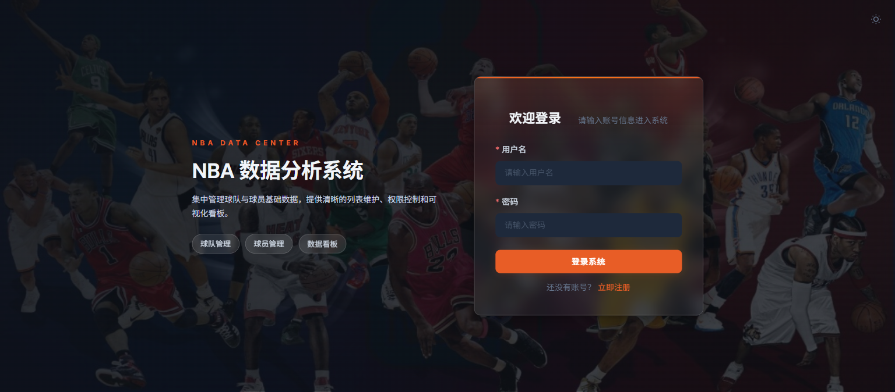

<p align="center">
  
</p>

<h1 align="center">NBAManager</h1>

<p align="center">
  <strong>全栈 NBA 数据管理与智能分析平台</strong>
</p>

<p align="center">
  <a href="#功能特性">功能特性</a> •
  <a href="#技术栈">技术栈</a> •
  <a href="#快速开始">快速开始</a> •
  <a href="#项目结构">项目结构</a> •
  <a href="#api-接口">API</a> •
  <a href="#环境变量">环境变量</a> •
  <a href="#许可证">许可证</a>
</p>

---

## 项目简介

NBAManager 是一个基于 **Spring Boot + Vue 3 + Python** 的全栈 NBA 数据平台，集成了实时数据采集、AI 智能问答（RAG）、比赛回放分析、LangGraph 多智能体系统等能力。

核心定位：**不是简单的数据展示，而是一个可交互、可分析、可对话的 NBA 数据产品。**

---

## 功能特性

### 📊 数据中心

| 功能 | 说明 |
|------|------|
| **数据仪表盘** | 球队排名概览、得分榜 Top 8、今日比赛实时比分卡片、AI Copilot 快捷入口 |
| **球队管理** | 30 支 NBA 球队、东西部联盟与分区排名、球队详情（战绩、数据、交锋记录）、关注/收藏 |
| **球员数据** | 500+ 球员资料（NBA API 同步）、卡片/表格双视图、Excel 导出、生涯趋势图（ECharts 雷达图 + 折线图）、投篮热力图（SVG，真实 NBA API 数据）、球员对比（双雷达 + 数据表）、关注/收藏 |
| **比赛记录** | 比赛详情：Box Score、逐节比分、Play-by-Play、投篮分布图、实时聊天室（WebSocket） |
| **伤病报告** | 伤病报告追踪与展示 |

### 📰 新闻与社区

| 功能 | 说明 |
|------|------|
| **比赛新闻** | 实时比赛新闻（ESPN 数据源）、今日比赛卡片与实时比分、新闻收藏与浏览历史 |
| **社区互动** | 帖子（讨论/新闻/辩论/预测 + 投票）、评论与回复系统（树形结构、置顶、作者互动标记）、点赞与收藏、热帖排行 |
| **通知系统** | 点赞/评论/收藏/回复/比赛更新通知、浏览器推送通知支持 |
| **投票系统** | 社区帖子集成投票功能 |

### 🏆 季后赛与选秀

| 功能 | 说明 |
|------|------|
| **季后赛对阵图** | 东西部联盟对称布局、实时比分与系列赛进度、球队 Logo 展示 |
| **NBA 选秀** | 选秀顺位数据库与管理 |
| **历史数据** | 近 3 个赛季存储、赛季数据排行、球队表现图表与排名表、赛季切换与球队筛选 |

### 🤖 AI 智能系统

| 功能 | 说明 |
|------|------|
| **RAG 智能问答** | ChromaDB 向量数据库 + MIMO LLM、混合检索：向量 + BM25 + CrossEncoder 重排序、SQL 结构化查询优先（球队/球员/比赛/排名）、百度搜索补充（新闻类查询）、证据门控防幻觉机制、SSE 流式输出、对话历史持久化与分享 |
| **AI 比赛回放** | 基于真实 Play-by-Play 的事件回放、时间轴（Timeline）、走势折线图（Momentum）、精彩瞬间（Highlights）、关键转折点（Turning Points）、MIMO AI 解释生成、事实引用校验（Grounding Validator） |
| **NBA Copilot** | LangGraph 多智能体架构、Supervisor 路由 + 专业 Agent（Replay/Stats/Player/Team/News/Search/Draft）、MIMO v2.5 Pro 作为 LLM Provider、对话记忆与上下文追问 |
| **投篮热力图** | 球员级 + 比赛级投篮图、真实 NBA ShotChartDetail API 数据、主队/客队筛选、命中/未中筛选、SVG 半场球场渲染 |

### 👤 用户系统

| 功能 | 说明 |
|------|------|
| **认证** | 注册与登录（JWT 认证） |
| **个人中心** | 关注的球员/球队、收藏的帖子/新闻、浏览历史、头像上传、密码/用户名修改 |
| **管理后台** | 数据管理中心（同步进度、暂停/取消）、模块化同步（球队/球员/比赛/新闻/季后赛/选秀等）、全量同步与单模块同步 |

---

## 技术栈

### 前端

| 技术 | 版本 | 用途 |
|------|------|------|
| Vue 3 | ^3.4.21 | 核心框架 |
| TypeScript | ~5.4.0 | 类型安全 |
| Vite | ^5.2.8 | 构建工具 |
| Element Plus | ^2.6.3 | UI 组件库 |
| ECharts + vue-echarts | ^5.5.0 / ^6.6.9 | 数据可视化 |
| Pinia | ^2.1.7 | 状态管理 |
| Vue Router | ^4.3.0 | 路由 |
| Axios | ^1.6.8 | HTTP 客户端 |
| STOMP.js + SockJS | ^7.3.0 / ^1.6.1 | WebSocket 实时通信 |
| XLSX + file-saver | ^0.18.5 / ^2.0.5 | Excel 导出 |

### 后端

| 技术 | 版本 | 用途 |
|------|------|------|
| Java | 17 | 运行时 |
| Spring Boot | 3.2.5 | 应用框架 |
| Spring Security + JWT | jjwt 0.12.5 | 认证授权 |
| Spring Data JPA (Hibernate) | — | ORM |
| Spring WebSocket | — | 实时通信 |
| Spring Data Redis | — | 缓存 |
| Lombok | 1.18.32 | 代码简化 |
| MySQL Connector | runtime | 数据库驱动 |

### AI / RAG / 数据采集

| 技术 | 版本 | 用途 |
|------|------|------|
| Python | 3.12+ | 运行时 |
| FastAPI | >=0.115.0 | RAG/Copilot HTTP 服务 |
| LangChain (core, openai, chroma, community, huggingface) | >=0.3.0 | RAG 框架 |
| ChromaDB | >=1.0.0 | 向量数据库 |
| sentence-transformers | >=3.0.0 | 文本嵌入 |
| PyTorch | >=2.0.0 | 深度学习后端 |
| BAAI/bge-reranker-v2-m3 | — | 重排序模型 |
| richinfoai/ritrieve_zh_v1 | — | 中文嵌入模型 |
| nba_api | >=1.11.0 | NBA Stats API 客户端 |
| MIMO v2.5 Pro | — | LLM（小米 MIMO） |

### 基础设施

| 技术 | 版本 | 用途 |
|------|------|------|
| MySQL | 8.0+ | 关系型数据库 |
| Redis | 6.0+ | 缓存 |
| ChromaDB | — | 向量数据库 |
| CUDA（可选） | 12.4+ | GPU 加速嵌入/重排序 |

---

## 快速开始

### 前置要求

- Java 17+
- Node.js 18+
- Python 3.12+
- MySQL 8.0+
- Redis 6.0+
- CUDA 12.4+（可选，RAG GPU 加速）

### 1. 克隆项目

```bash
git clone https://github.com/quanyechaTAT/NBAManager.git
cd NBAManager
```

### 2. 配置环境变量

```bash
cp .env.example .env
```

编辑 `.env` 文件：

```env
# 数据库
DB_USERNAME=root
DB_PASSWORD=your_password_here

# MIMO AI（小米大模型）
MIMO_API_KEY=your_mimo_api_key_here
MIMO_BASE_URL=https://token-plan-cn.xiaomimimo.com/v1

# 代理（可选，访问 stats.nba.com）
NBA_PROXY_HOST=
NBA_PROXY_PORT=

# Redis
REDIS_HOST=localhost
REDIS_PORT=6379
REDIS_PASSWORD=

# JWT
JWT_SECRET=your-random-secret-at-least-256-bits

# 初始账号
ADMIN_USER=admin
ADMIN_PASS=your_admin_password_here
USER_USER=user
USER_PASS=your_user_password_here
```

### 3. 安装依赖

```bash
# 后端
cd backend && ./mvnw install -DskipTests && cd ..

# 前端
cd frontend && npm install && cd ..

# Python（推荐使用虚拟环境）
cd backend/scripts
python -m venv venv
# Windows:
venv\Scripts\activate
# macOS/Linux:
# source venv/bin/activate
pip install -r requirements.txt
cd ../..
```

### 4. 启动服务

需要 **4 个终端窗口**：

```bash
# 终端 1：后端（Spring Boot）
cd backend
./mvnw spring-boot:run -Dspring-boot.run.profiles=local

# 终端 2：前端（Vite 开发服务器）
cd frontend
npm run dev

# 终端 3：RAG 服务（FastAPI）
cd backend/scripts
python -m rag_app.main 8899

# 终端 4（可选）：NBA Copilot 服务
cd backend/scripts/nba_copilot_app
python main.py
```

### 5. 访问应用

| 服务 | 地址 |
|------|------|
| 前端 | http://localhost:5173 |
| 后端 API | http://localhost:8080 |
| RAG 服务 | http://localhost:8899 |
| NBA Copilot | http://localhost:8898 |

首次启动会自动初始化演示账号（使用 `.env` 中配置的用户名密码）。

---

## 项目结构

```
NBAManager/
├── .env.example                    # 环境变量模板
├── .env                            # 环境变量（gitignored）
├── LICENSE                         # MIT License
├── README.md
│
├── backend/                        # Spring Boot 后端
│   ├── pom.xml                     # Maven 配置
│   ├── mvnw / mvnw.cmd             # Maven Wrapper
│   ├── src/main/java/com/nbamanager/
│   │   ├── NbaManagerApplication.java    # 入口
│   │   ├── config/                       # 配置类（7 个）
│   │   ├── domain/                       # JPA 实体（40+）
│   │   ├── repository/                   # JPA 仓库（35+）
│   │   ├── service/                      # 业务逻辑（30+）
│   │   ├── web/                          # REST 控制器（26 个）
│   │   ├── security/                     # JWT 认证
│   │   └── util/                         # 工具类
│   ├── src/main/resources/
│   │   ├── application.yml               # 主配置
│   │   └── db/migration/                 # SQL 迁移脚本
│   ├── src/test/                         # 单元测试
│   └── scripts/                          # Python 服务
│       ├── nba_data_fetcher.py           # NBA 数据采集（3200+ 行）
│       ├── rag_app/                      # RAG FastAPI 服务（端口 8899）
│       ├── nba_copilot_app/              # LangGraph Copilot 服务（端口 8898）
│       └── requirements.txt              # Python 依赖
│
├── frontend/                        # Vue 3 前端
│   ├── package.json
│   ├── vite.config.ts               # Vite 配置
│   └── src/
│       ├── api/                     # API 调用封装
│       ├── components/              # 组件
│       ├── views/                   # 页面视图（18 个）
│       ├── router/                  # 路由配置
│       ├── stores/                  # Pinia 状态
│       └── styles/                  # 全局样式
│
└── docs/                            # 文档
    ├── ai-game-replay-mimo-langgraph-task-plan.md
    └── superpowers/
        ├── plans/                   # 实现计划
        └── specs/                   # 设计规格
```

---

## API 接口

### 认证

| 方法 | 路径 | 说明 |
|------|------|------|
| POST | `/api/auth/login` | 用户登录 |
| POST | `/api/auth/register` | 用户注册 |

### 数据

| 方法 | 路径 | 说明 |
|------|------|------|
| GET | `/api/teams` | 球队列表 |
| GET | `/api/teams/{id}` | 球队详情 |
| GET | `/api/players` | 球员列表 |
| GET | `/api/players/{id}` | 球员详情 |
| GET | `/api/match-records` | 比赛记录 |
| GET | `/api/match-detail/{gameId}/boxscore` | Box Score |
| GET | `/api/match-detail/{gameId}/playbyplay` | Play-by-Play |
| GET | `/api/match-detail/{gameId}/quarters` | 逐节比分 |
| GET | `/api/news` | 新闻列表 |
| GET | `/api/dashboard/overview` | 仪表盘概览 |

### AI Replay

| 方法 | 路径 | 说明 |
|------|------|------|
| GET | `/api/ai-replay/games/{gameId}/timeline` | 比赛时间轴 |
| GET | `/api/ai-replay/games/{gameId}/momentum` | 走势数据 |
| GET | `/api/ai-replay/games/{gameId}/highlights` | 精彩瞬间 |
| GET | `/api/ai-replay/games/{gameId}/turning-points` | 关键转折 |
| GET | `/api/ai-replay/games/{gameId}/summary` | AI 赛后总结 |
| POST | `/api/ai-replay/games/{gameId}/events/{eventId}/explain` | AI 事件解释 |

### 投篮图

| 方法 | 路径 | 说明 |
|------|------|------|
| GET | `/api/shot-chart/player/{playerId}` | 球员投篮图 |
| GET | `/api/shot-chart/game/{gameId}` | 比赛投篮图 |

### 季后赛

| 方法 | 路径 | 说明 |
|------|------|------|
| GET | `/api/nba/playoff` | 季后赛对阵图 |
| POST | `/api/nba/playoff/sync` | 同步季后赛数据 |

### NBA Copilot

| 方法 | 路径 | 说明 |
|------|------|------|
| POST | `/api/nba-copilot/chat` | AI 对话 |
| GET | `/api/nba-copilot/conversations` | 对话列表 |

### RAG

| 方法 | 路径 | 说明 |
|------|------|------|
| GET | `/api/rag/stream` | SSE 流式问答 |
| GET | `/api/rag/stats` | RAG 统计 |

### 社区

| 方法 | 路径 | 说明 |
|------|------|------|
| GET | `/api/posts` | 帖子列表 |
| POST | `/api/posts` | 发帖 |
| GET | `/api/comments/{postId}` | 评论列表 |
| POST | `/api/comments` | 发评论 |

---

## 环境变量

### 核心变量（`.env`）

| 变量 | 必需 | 说明 |
|------|------|------|
| `DB_USERNAME` | ✅ | MySQL 用户名 |
| `DB_PASSWORD` | ✅ | MySQL 密码 |
| `MIMO_API_KEY` | ✅ | MIMO AI API 密钥 |
| `MIMO_BASE_URL` | ❌ | MIMO API 地址（默认：`https://token-plan-cn.xiaomimimo.com/v1`） |
| `JWT_SECRET` | ✅ | JWT 签名密钥（至少 256 位） |
| `NBA_PROXY_HOST` | ❌ | NBA API 代理主机 |
| `NBA_PROXY_PORT` | ❌ | NBA API 代理端口 |
| `REDIS_HOST` | ❌ | Redis 主机（默认：`localhost`） |
| `REDIS_PORT` | ❌ | Redis 端口（默认：`6379`） |
| `REDIS_PASSWORD` | ❌ | Redis 密码 |
| `ADMIN_USER` | ❌ | 管理员用户名（默认：`admin`） |
| `ADMIN_PASS` | ❌ | 管理员密码 |
| `USER_USER` | ❌ | 普通用户名（默认：`user`） |
| `USER_PASS` | ❌ | 普通用户密码 |

### RAG 专用变量

| 变量 | 默认值 | 说明 |
|------|--------|------|
| `RAG_EMBEDDING_MODEL` | `richinfoai/ritrieve_zh_v1` | 嵌入模型 |
| `RAG_RERANKER_MODEL` | `BAAI/bge-reranker-v2-m3` | 重排序模型 |
| `RAG_LLM_MODEL` | `mimo-v2.5-pro` | LLM 模型 |
| `RAG_VECTOR_K` | `8` | 向量检索数量 |
| `RAG_RERANK_TOP_K` | `5` | 重排序后保留数量 |
| `RAG_DISTANCE_THRESHOLD` | `0.68` | 距离阈值 |
| `RAG_PORT` | `8899` | RAG 服务端口 |
| `RAG_WEB_SEARCH_ENABLED` | `true` | 是否启用百度搜索 |
| `RAG_MEMORY_WINDOW` | `5` | 对话记忆窗口 |

### Copilot 专用变量

| 变量 | 默认值 | 说明 |
|------|--------|------|
| `NBA_MANAGER_API` | `http://localhost:8080` | 后端 API 地址 |
| `NBA_COPILOT_PORT` | `8898` | Copilot 服务端口 |

---

## 运行测试

```bash
# 后端单元测试
cd backend && ./mvnw test

# Python 测试
cd backend/scripts && pytest test_nba_draft_providers.py test_playoff_bracket_mapping.py

# 前端构建验证
cd frontend && npm run build
```

---

## 部署

### 构建生产版本

```bash
# 后端
cd backend && ./mvnw clean package -DskipTests

# 前端
cd frontend && npm run build
# 输出到 frontend/dist/
```

### 部署建议

- **后端**：`java -jar backend/target/nba-manager-backend-1.0.0.jar --spring.profiles.active=prod`
- **前端**：将 `frontend/dist/` 部署到 Nginx 或 CDN
- **Python 服务**：使用 `systemd` 或 `supervisor` 管理 RAG 和 Copilot 进程
- **数据库**：MySQL 8.0+，建议配置主从复制
- **缓存**：Redis 6.0+，建议配置持久化

---

## 设计规范

- **暗色主题**：默认主题，参考篮球场灯光氛围
- **亮色主题**：支持切换
- **设计语言**：`Courtside Intelligence`——专业体育数据媒体风格
- **响应式**：支持桌面端和移动端
- **国际化**：球队名/球员名自动翻译为中文（MIMO AI 翻译）

---

## 贡献指南

1. Fork 本仓库
2. 创建特性分支：`git checkout -b feature/your-feature`
3. 提交更改：`git commit -m 'feat: add your feature'`
4. 推送分支：`git push origin feature/your-feature`
5. 创建 Pull Request

### 提交规范

使用 [Conventional Commits](https://www.conventionalcommits.org/)：

- `feat:` 新功能
- `fix:` 修复
- `docs:` 文档
- `style:` 格式
- `refactor:` 重构
- `test:` 测试
- `chore:` 构建/工具

---

## 许可证

[MIT License](LICENSE) © 2026 NBA Manager

---

## 致谢

- [nba_api](https://github.com/swar/nba_api) — NBA Stats API Python 客户端
- [Element Plus](https://element-plus.org/) — Vue 3 UI 组件库
- [ECharts](https://echarts.apache.org/) — 数据可视化库
- [Spring Boot](https://spring.io/projects/spring-boot) — Java 应用框架
- [FastAPI](https://fastapi.tiangolo.com/) — Python Web 框架
- [LangChain](https://langchain.com/) — LLM 应用框架
- [ChromaDB](https://www.trychroma.com/) — 向量数据库
- [MIMO](https://xiaomimimo.com/) — 小米大语言模型
