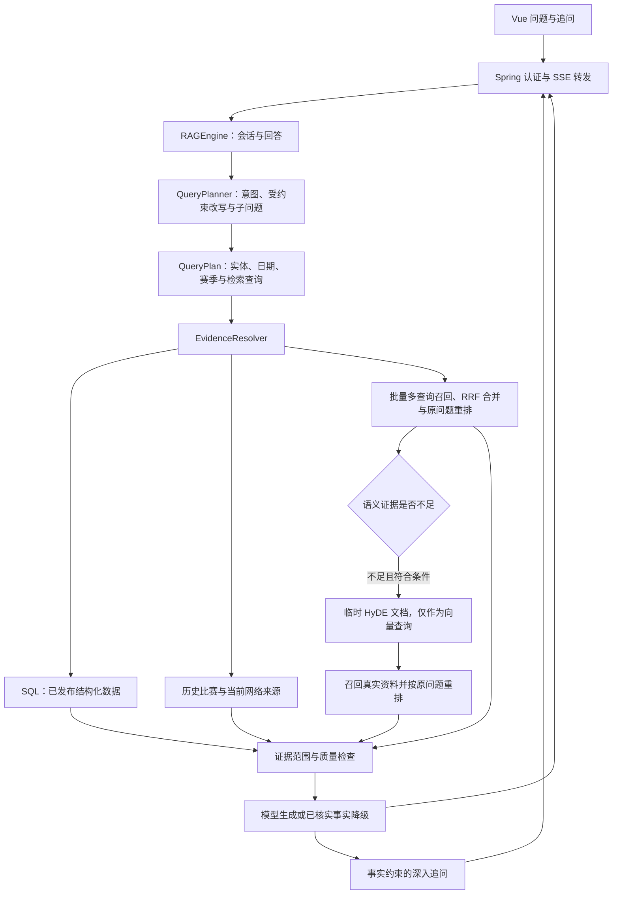

# AI 助手架构调整与验证

## 结论与改动范围

采用核心问答链路的局部重构，保留 Spring 认证入口、Python 数据与模型能力、Vue SSE 事件协议和现有数据发布规则。主要问题集中在证据选择、依赖耦合、会话状态和流式资源管理，整体替换框架不会直接解决这些问题。

重构后，`RAGEngine` 负责会话、生成和响应；`QueryPlan` 统一解释问题范围；`EvidenceResolver.resolve(plan)` 封装来源顺序、范围校验、依赖故障降级和证据诊断。流式与非流式入口共用同一套准备过程，避免两种回答行为分叉。

本轮沿“用户提问 → 意图识别 → 问题改写 → 可选假设文档 → 检索回答”进一步实现查询规划。假设文档作为临时向量查询使用，不能成为事实；先执行常规召回，有合格语义材料或可信比赛来源时跳过 HyDE。这样避免在每个比分问题前增加两次模型请求。



## 发现的问题与处理

| 问题 | 调整后的行为 |
| --- | --- |
| 数据库连接异常会使整个问答失败 | SQL、向量、联网分别隔离故障，记录来源状态和耗时；数据库连接使用明确超时 |
| 历史比赛混用当前球队赛季统计 | 比赛证据必须匹配双方、日期或赛季；可信历史来源取得比赛后清除其他日期的 SQL/向量材料 |
| 本地只有比分时停止补查 | 分析及技术统计问题仍查询历史比赛详情 |
| 已有可信比赛详情还执行昂贵向量检索 | 历史比赛优先使用比赛来源，跳过向量模型；模型未加载也可回答 |
| 实体筛选无结果时退回全库 | 保留原实体筛选条件，不用其他球队填充结果 |
| 所有重排结果不合格时恢复低分文档 | 严格执行质量阈值，全部不合格即为空 |
| 今天、昨天与英文实时问题可能选到旧比赛 | 共享时效判断，当前比赛问题不进入“最近一次历史交锋”路径 |
| 跨年赛季被附加自然年过滤 | 赛季范围覆盖下一自然年，例如 2024-25 赛季的 2025 年比赛 |
| 模型配置覆盖后仍加载写死的默认缓存 | 按配置模型 ID 选择缓存，优先采用 Hugging Face `refs/main` 指向的快照 |
| 缓存随查询或会话数量不断增长 | 搜索采用有容量上限的 TTL/LRU 缓存，会话采用容量上限、空闲 TTL 和原子读写 |
| 持久化的旧历史覆盖刚完成的回答 | 历史只能初始化或在有重叠依据时延长当前状态，不能回滚较新的对话 |
| 同一会话多个回答并行写入历史 | 会话占用覆盖整个问答，重叠请求明确返回忙碌错误；结束、异常或生成器关闭时释放 |
| 长连接占用同步任务线程或无界排队 | Java MVC 使用独立有界线程池，队列为零，容量耗尽返回 429；保留原异步超时配置 |
| 追问只是通用统计模板 | 根据已核实差异提出解释问题，并跨轮跳过讨论过的主题 |
| 模型根据总篮板和总出手推断缺失的回合事实 | 明确禁止对未知二次进攻得分、回合数作正向或负向判断；后端只提供能与最终比分核对一致的得分构成 |

## 回答与追问的事实约定

`QueryPlanner.plan(...)` 输出事实、分析、解释、比较、新闻或赛程意图，并保留原问题作为第一个查询。复杂且不需要实时信息的语义问题可用一次 JSON 模型请求生成改写和子问题；简单统计、当前查询和已限定比赛使用规则路径。辅助请求默认 HTTP 超时 5 秒，规划输出最多 512 tokens，HyDE 最多 320 tokens，关闭思考模式；失败或截断后退回规则及已有证据，不修改回答模型的全局配置。

每个候选必须保留识别出的全部球队、球员、日期、赛季、赛事类型及相对时间限定。增加新实体、旧日期、比分或数字的候选会被排除。中英文球队和球员名称共享别名识别。子问题参与文本召回，并在生成提示中单独标记为任务；用户问题里的判断也必须先验证，不能直接当作事实。

文本检索默认最多 3 个查询，在同一批中编码并查询 Chroma。每路最多 60 条候选，按文本归一化去重，使用 RRF（常数 60）融合排序，再对最多 60 条真实候选按用户的原始独立问题重排。扩大语义来源到新闻和历史文本后，仍检查实体与时间范围，保留向量距离和重排阈值，不能用不合格文档填充结果。

HyDE 对缺少合格新闻语义材料的分析、解释、比较问题补充；历史球员统计本身不能证明战术原因，新闻材料的原问题重排分数达到 0.4 才作为足够的语义材料跳过补充。比分、事实、当前信息、指定比赛、已有可信网络结果及向量准备期间也跳过。假设文档只能存在于当前调用栈及模型/向量请求内，不会添加到知识库、回答提示、来源、会话或诊断内容中。诊断仅记录触发原因、耗时和最终真实文档数量。其失败不能丢弃已经取得的真实证据。实现依据 [HyDE 原始论文](https://aclanthology.org/2023.acl-long.99/)；JSON 规划遵循 [DeepSeek JSON 输出说明](https://api-docs.deepseek.com/guides/json_mode/)。

球员实体优先匹配完整姓名和明确的英文别名；“赛斯·库里”不会因为姓氏包含“库里”而被识别为“斯蒂芬·库里”，“詹姆斯·怀斯曼”也不会被识别为勒布朗。球员与历史统计文档还需要校验元数据中的姓名。生成提示附带来源、质量和赛季，未独立验证的新闻只能作为报道引用。

没有指定日期的两队比赛分析，选择最近一次可核实的直接交锋并说明日期；指定日期、年份、赛季或季后赛后，来源必须满足该范围。请求的具体比赛没有证据时保留明确的不足提示，不用另一场比赛作答。

2024-12-25 马刺对尼克斯的验证来源提供马刺 114:117 尼克斯、双方技术统计和得分较高球员。后端可核算：马刺两分球 52 分、三分球 48 分、罚球 14 分；尼克斯分别为 64、39、14 分。构成之和不等于该队最终比分时，不向模型提供这项计算结果。

追问示例：

- “马刺投篮命中率 51% 高于尼克斯的 45% 却输球，结合出手次数、三分和罚球，如何解释得分构成？”
- “尼克斯多 9 个进攻篮板、少 10 次失误：结合双方投篮出手数，能支持哪些判断，还缺哪些因果证据？”
- “比较已列出的球员 Mikal Bridges 和 Victor Wembanyama 的得分占全队比例，并结合篮板和助攻说明贡献与判断局限。”

这些前提来自同一场比赛。统计不足时退回能够回答的基础追问；未核实的轮换、对位、防守战术和逐回合因果关系不会作为确定前提。深入解释使用分析预算，避免按简短比分查询的预算截断回答。

## 运行与资源约定

本机排查发现旧 Chroma 中 2,097 条文档均缺少 `data_contract_version=2`，而检索已经要求该版本，导致所有文本召回为空。现在启动时会检测空索引、旧格式索引和中断的迁移，从数据库重新读取可发布记录，复用已加载的向量模型进行 upsert，并清除已失去发布资格的旧版本 2 条目。旧文本不会直接获得可信标签；未验证的数字仍被数据发布规则屏蔽。本机可发布的数据集为 1,008 条。

索引准备在后台进行，API 与可信比赛查询继续可用，向量检索在准备阶段暂停。迁移完成后后续启动复用索引。管理员主动重建同样复用模型，并使用锁阻止重复任务；清空数据保留 Chroma collection 身份，避免正在使用的检索器持有已删除的集合。`index_report.json` 记录 building/failed/ok，失败的部分迁移会在下次启动重试。当前仍采用单进程索引生命周期；多进程部署需要共享任务协调。

| 配置/接口 | 默认值或语义 |
| --- | --- |
| Python `/health` | API 可用时返回 200，附带 `model_loaded`；不等待向量模型 |
| Python `/ready` | 向量检索可用时返回 200，预加载中返回 503 |
| `RAG_MEMORY_MAX_SESSIONS` | 256，会话缓存最大条目数 |
| `RAG_MEMORY_TTL_SECONDS` | 3600，会话空闲过期时间 |
| `RAG_SEARCH_CACHE_MAX_ENTRIES` | 256，查询结果缓存最大条目数 |
| `RAG_SEARCH_CACHE_TTL_SECONDS` | 600，查询结果缓存有效期 |
| `RAG_DB_CONNECT_TIMEOUT_SECONDS` | 3，SQL 连接超时 |
| `RAG_QUERY_PLANNER_MODE` | auto，复杂语义问题可用模型；rules 关闭模型规划 |
| `RAG_QUERY_PLANNER_TIMEOUT_SECONDS` | 5，规划独立 HTTP 超时，限制为 1–10 秒 |
| `RAG_MULTI_QUERY_LIMIT` | 3，常规检索查询数量，限制为 1–4 |
| `RAG_HYDE_ENABLED`、`RAG_HYDE_TIMEOUT_SECONDS` | true、5，可选补充与独立 HTTP 超时 |
| `RAG_AUTO_BUILD_INDEX` | true，后台初始化或迁移不合规索引 |
| `app.rag.stream.max-concurrent` | 16，Java MVC 流式工作线程上限；环境变量 `APP_RAG_STREAM_MAX_CONCURRENT` |
| `app.rag.stream.timeout-millis` | 可选覆盖，缺省沿用 `spring.mvc.async.request-timeout`，项目通过 `RAG_ASYNC_TIMEOUT_MS` 配置 |
| Python 问答并发 | `/query` 与 `/stream` 共用 8 个在途额度 |

Java 的线程额度、Python 的问答额度和会话占用各自覆盖对应工作生命周期。Python SSE 队列最多保留两个待发事件；客户端断开后，阻塞中的上游工作直到退出才归还问答额度，避免用取消请求绕过并发限制。

缓存与会话占用都是单进程状态；当前适用于项目的单 Python 工作进程部署。若扩展到多个工作进程，应将会话版本及占用迁移到共享存储，不能依赖本地锁实现跨进程顺序。更换向量模型后应重建对应索引，避免将不同向量空间混用。

## 验证

本轮查询路线优化的最终验证：

- Python：145 项相关测试通过；本轮增加 33 项检查，覆盖受约束模型规划、子问题参与检索、原问题重排、HyDE 隔离与超时、同姓球员、索引迁移与中断恢复。
- 前端：18 项相关测试及类型检查通过。Java 本轮未修改；实际 HTTP 检查使用现有 Java 服务转发新版 Python SSE。
- 六项真实 HTTP 检查通过：SQL 事实、明确日期的历史比赛分析、上下文追问，以及冷启动与模型就绪后的语义问题。全部完成事件正常，临时账户和数据库会话清理成功。
- 旧索引更新后共有 2,204 条物理记录，其中 1,008 条满足版本 2 的发布要求；1,196 条旧记录继续被查询过滤。下一次启动记录 `Index contract check: current`，没有再次执行迁移。

最终一次比赛分析和上下文追问分别返回 412、304 个正文片段；状态事件约在 0–0.03 秒到达。向量就绪后的两个语义问题分别返回 150、136 个片段，均实际触发 HyDE，正文首块约在 13.05、7.67 秒到达。复杂问题的模型规划约 1 秒，CPU 多路检索与补充仍有额外成本；这些是本机当次测量，不代表其他环境或外部服务的性能。

“马刺弱侧协防”“库里无球跑动”的当前资料能提供背景与赛季数据，仍缺少直接战术、录像或追踪证据。真实回答明确限定可证明的部分，并列出缺失资料；本轮没有用假设文档补造战术结论。检索方案的通用准确率提升还需要标注问题集评估，不能从这六项检查推算。

本机详细记录位于忽略目录 `test-evidence/rag-route-v3/`，包括迁移前快照、索引审计、SSE 诊断和最终验证汇总。运行本轮测试可在下面的 Python 命令中再加入 `tests/test_query_route.py tests/test_index_lifecycle.py`。

2026-10-05 上一轮架构调整的验证结果：

- Python：112 项相关测试通过，包含数据库故障隔离、比赛与赛事类型范围、实时查询、跨年赛季、模型缓存选择、严格重排、会话过期与并发、深入追问和得分核算。
- Java：22 项相关测试通过，包含真实 HTTP 流式增量转发、用户会话归属、有界线程池拒绝与恢复，以及原异步超时配置的保留。
- Vue：类型检查通过，18 项相关测试通过；SSE 与追问协议保持兼容。

本地通过临时登录账户验证 Java → Python → 比赛来源 → 模型的完整链路，问题包含普通历史对阵分析、推荐的深入追问、2024-12-25 对阵、持久化会话中的“这场比赛”，以及非流式统计对比。最终详细结果保存于本机忽略目录 `test-evidence/ai-assistant-v2/live/`；临时账户和持久化会话在验证结束后删除。

预热并命中来源缓存的一组验证中，四次流式问答分别收到 432、495、616、127 个正文片段，正文首块约 0.34–0.77 秒到达，状态事件在约 0–0.02 秒到达。该测量对应本机与当次外部服务状态，不是性能承诺；最终重启 Python 后，未缓存的首个历史分析约 16.7 秒收到正文，约 18 秒完成，状态事件在约 0.02 秒到达。

另外观察到一次模型网络连接失败：来源数据已经取得，SSE 发送降级状态并以 `done.degraded=true` 返回已核实事实，没有将其冒充模型分析。记录保存在 `fallback-observation.json`。API 就绪与向量预加载分离也在重启后的真实健康检查中确认：历史回答可以在 `model_loaded=false` 期间完成。

相关命令：

```powershell
# backend/scripts
.\venv312\Scripts\python.exe -m pytest tests/test_assistant_architecture.py tests/test_ai_assistant_quality.py tests/test_rag_engine_regressions.py tests/test_rag_stream_gate.py tests/test_search_system.py tests/test_game_archive.py tests/test_index_provenance.py -q

# backend
.\mvnw.cmd -q '-Dtest=RagStreamingConfigTest,RAGControllerTest,RAGConversationServiceTest,RagTimeoutPropertiesTest' test

# frontend
npm.cmd run typecheck
npm.cmd run test:run -- src/views/SmartSearchView.test.ts src/utils/smartSearchHelpers.test.ts
```

外部来源覆盖范围和模型生成质量仍决定可回答内容。缺少数据时只回答有证据支持的部分；这里的重构保证来源选择与降级流程，不代表所有历史赛事或战术问题都有完整数据。
