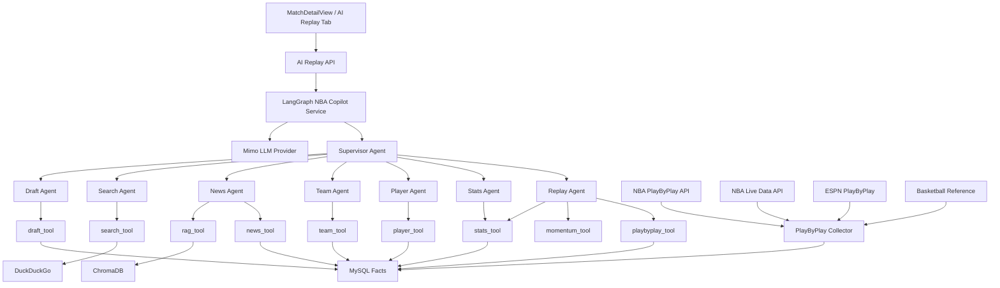
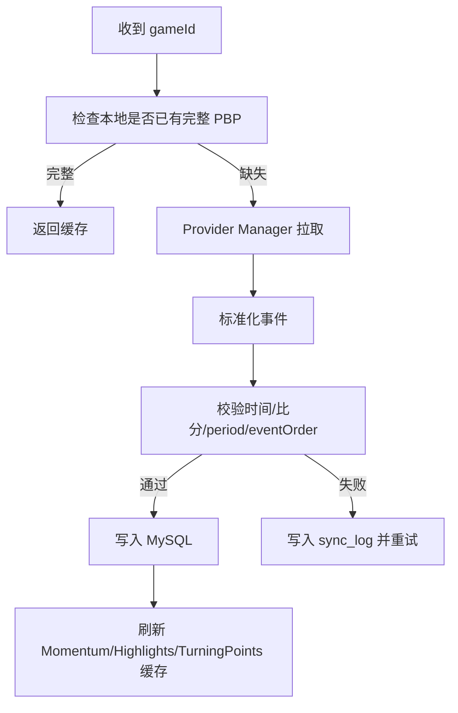
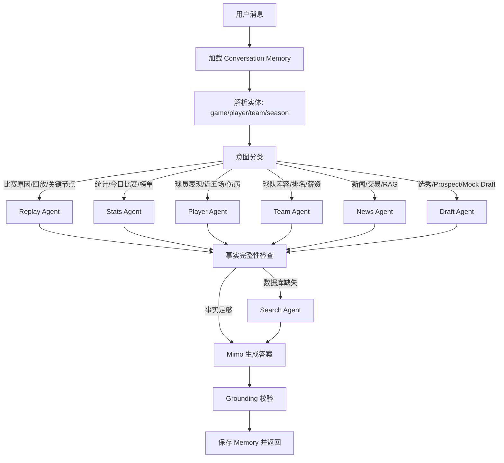
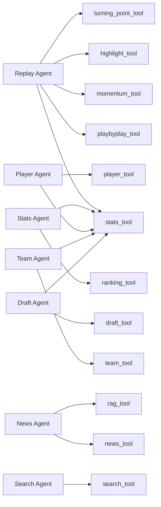

# AI Game Replay + NBA Copilot 任务文档

本文档是 NBAManager 项目实现 **AI Game Replay** 与 **LangGraph NBA Copilot 多智能体系统** 的完整任务说明书。目标是让后续开发者或 DeepSeek 按任务逐项实现，而不是只给抽象方案。

当前 AI 助手接入的模型为 **小米 Mimo**，项目中已有 `MIMO_API_KEY`、`MIMO_BASE_URL` 环境变量，以及 `mimo-v2.5`、`mimo-v2.5-pro` 的调用痕迹。后续所有 AI Replay 与 NBA Copilot 的大模型调用，统一通过 Mimo Provider 层完成，不再写成 DeepSeek 专用调用。

## 1. 背景与现状

### 1.1 现有能力

项目当前已经具备以下基础：

- 前端比赛详情页已有 `比赛回放` Tab，但目前缺完整回放数据展示。
- 后端已有 `PlayByPlay` 实体、`PlayByPlayRepository`、`PlayByPlayDto`。
- 后端已有 `/api/match-detail/{gameId}/playbyplay` 接口。
- `backend/scripts/nba_data_fetcher.py` 已经接入 NBA `PlayByPlayV3`、`ScoreboardV3`、`BoxScoreTraditionalV3`。
- RAG 服务已经通过 Python 常驻服务调用 Mimo，并使用 ChromaDB。
- 当前比赛详情和采集脚本已经传递 `MIMO_API_KEY`、`MIMO_BASE_URL` 到 Python 环境。

### 1.2 现有不足

必须修复或补齐：

- `PlayByPlay` 表字段过薄，无法承载企业级回放需要的事件序号、来源、动作类型、球队名、原始 payload、引用链。
- Play-by-Play Provider 没有统一抽象，业务层仍可能直接依赖具体数据源。
- 回放 Tab 只显示空状态，没有 Timeline、Momentum、AI Explain、Highlights、Turning Points。
- AI 能力当前偏 RAG/翻译，没有面向比赛事实的可信分析链路。
- 缺少 LangGraph Supervisor 与多 Agent 路由。
- 缺少 Conversation Memory，使“第四节呢？”这种上下文追问无法稳定理解。
- AI 输出没有事实引用校验，无法证明每句话来自真实数据。

## 2. 核心原则

实现时必须遵守：

1. 所有比赛事实只来自官方或可追溯数据源。
2. AI 不能编造比赛事件、比分、时间、球员、球队、伤病、回合。
3. AI 只能解释、总结、分析和预测影响。
4. 每个 AI 输出必须带引用：`eventId`、`statKey`、`source` 或 `rawPayloadHash`。
5. 业务层不能直接调用 NBA、ESPN 或网页解析；必须经过 Provider、Collector、Tool。
6. 所有 Agent 不能直接访问数据库；必须通过 Tool。
7. Mimo 是当前唯一正式 LLM Provider；不要写死 DeepSeek。
8. Search Agent 只能作为数据库缺失时的兜底，搜索结果不能覆盖官方 Play-by-Play 事实。

## 3. 总目标

实现一个企业级 **AI Game Replay**：

- 不是视频播放器。
- 是基于真实 Play-by-Play 的事件回放、走势分析和 AI 解读系统。
- 同时升级 AI 助手为 **NBA Copilot**，由 LangGraph Supervisor 调度多个专业 Agent。

最终用户可以：

- 看一场比赛完整 Timeline。
- 按节、事件类型、球员、关键词筛选。
- 点击事件查看 Mimo 生成的解释。
- 查看比赛总结、Momentum 折线图、Turning Points、Highlights。
- 用自然语言追问：“为什么第三节输了？”、“第四节呢？”、“米切尔那波三分发生了什么？”。

## 4. 总体架构



## 5. 模块拆分

需要新增或改造以下模块：

1. `ai-replay`：比赛回放业务模块。
2. `playbyplay-provider`：统一数据源 Provider。
3. `playbyplay-collector`：采集、同步、重试、标准化。
4. `ai-tools`：Agent 可调用 Tool 层。
5. `nba-copilot`：LangGraph Supervisor 与多 Agent。
6. `mimo-provider`：统一 Mimo 调用封装。
7. `conversation-memory`：对话记忆和上下文实体解析。
8. `frontend ai-replay components`：Timeline、Momentum、Explain、Summary、Highlights。

## 6. 数据源 Provider 任务

### 6.1 目标

建立统一 Play-by-Play 数据源抽象，业务层只依赖 Provider Manager。

### 6.2 要做什么

新增接口：

```java
public interface PlayByPlayProvider {
    ProviderType type();
    boolean supports(String gameId);
    PlayByPlayFetchResult fetch(String gameId, PlayByPlayFetchOptions options);
}
```

新增枚举：

```java
public enum ProviderType {
    NBA_PLAY_BY_PLAY,
    NBA_LIVE,
    ESPN_PLAY_BY_PLAY,
    BASKETBALL_REFERENCE
}
```

新增 Provider：

- `NbaPlayByPlayProvider`
- `NbaLivePlayByPlayProvider`
- `EspnPlayByPlayProvider`
- `BasketballReferencePlayByPlayProvider`

### 6.3 数据源优先级

1. NBA PlayByPlay API
2. NBA Live Data API
3. ESPN PlayByPlay
4. Basketball Reference

### 6.4 怎么做

- Java Provider 不直接写复杂爬取逻辑，优先复用 Python 脚本或新增 Python 子命令。
- Provider Manager 按优先级调用。
- 每个 Provider 返回统一结构 `PlayByPlayFetchResult`。
- 每条事件必须包含 `source` 和 `rawPayloadJson`。
- 如果 Provider 失败，记录失败原因和耗时，继续尝试下一个 Provider。

### 6.5 验收标准

- 任意业务代码不能直接调用 NBA API。
- Collector 可通过统一入口采集任意 `gameId`。
- Provider 失败不会导致整个系统崩溃。
- 数据库能区分事件来源。

## 7. PlayByPlay Collector 任务

### 7.1 目标

建立稳定的比赛事件采集机制，支持赛后自动同步、手动同步和失败重试。

### 7.2 要做什么

新增服务：

- `PlayByPlayCollectorService`
- `PlayByPlaySyncScheduler`
- `PlayByPlayNormalizeService`
- `PlayByPlaySyncLogService`

### 7.3 Collector 流程



### 7.4 Scheduler

新增定时任务：

- 比赛结束后 15 分钟：采集 Play-by-Play。
- 比赛结束后 2 小时：二次校准。
- 每日凌晨：补采昨日失败比赛。
- 管理员接口：手动补采指定 gameId。

### 7.5 失败重试

重试策略：

- 第 1 次失败：5 分钟后重试。
- 第 2 次失败：30 分钟后重试。
- 第 3 次失败：6 小时后重试。
- 超过 3 次标记 `FAILED`，但允许手动重试。

## 8. 数据库任务

### 8.1 扩展 PlayByPlay 表

当前 `play_by_play` 表需要扩展。建议新增迁移脚本，而不是直接依赖 Hibernate 自动改表。

新增字段：

```sql
ALTER TABLE play_by_play
ADD COLUMN source VARCHAR(40) DEFAULT 'NBA_PLAY_BY_PLAY',
ADD COLUMN source_event_id VARCHAR(80),
ADD COLUMN event_order INT,
ADD COLUMN action_type VARCHAR(80),
ADD COLUMN team_name VARCHAR(120),
ADD COLUMN score_margin INT,
ADD COLUMN is_scoring_play BOOLEAN DEFAULT FALSE,
ADD COLUMN is_highlight_candidate BOOLEAN DEFAULT FALSE,
ADD COLUMN raw_payload_json JSON,
ADD COLUMN raw_payload_hash VARCHAR(64),
ADD COLUMN created_at DATETIME,
ADD COLUMN updated_at DATETIME;
```

新增索引：

```sql
CREATE INDEX idx_pbp_game_order ON play_by_play(game_id, period, event_order);
CREATE INDEX idx_pbp_game_player ON play_by_play(game_id, player_id);
CREATE INDEX idx_pbp_game_type ON play_by_play(game_id, event_type);
CREATE INDEX idx_pbp_source_event ON play_by_play(source, source_event_id);
```

### 8.2 新增 `game_momentum_snapshot`

用途：缓存比赛走势。

字段：

- `id`
- `game_id`
- `event_id`
- `period`
- `game_clock`
- `event_order`
- `home_score`
- `away_score`
- `score_margin`
- `leader_team_id`
- `created_at`

### 8.3 新增 `game_turning_point`

用途：保存关键转折点。

字段：

- `id`
- `game_id`
- `event_id`
- `period`
- `game_clock`
- `type`
- `confidence`
- `factual_reason`
- `ai_explanation`
- `cited_event_ids_json`
- `facts_hash`
- `created_at`

### 8.4 新增 `game_highlight`

用途：保存亮点事件。

字段：

- `id`
- `game_id`
- `event_id`
- `period`
- `game_clock`
- `highlight_type`
- `title`
- `description`
- `player_id`
- `team_id`
- `score_after`
- `created_at`

### 8.5 新增 `ai_replay_explanation`

用途：缓存事件解释，避免重复消耗 Mimo。

字段：

- `id`
- `game_id`
- `event_id`
- `agent_name`
- `model_provider`
- `model_name`
- `prompt_version`
- `facts_hash`
- `explanation`
- `cited_event_ids_json`
- `cited_stat_keys_json`
- `created_at`

### 8.6 新增 `ai_game_summary`

用途：缓存赛后总结。

字段：

- `id`
- `game_id`
- `summary_type`
- `model_provider`
- `model_name`
- `prompt_version`
- `facts_hash`
- `content`
- `cited_event_ids_json`
- `cited_stat_keys_json`
- `created_at`

### 8.7 新增 `ai_conversation_memory`

用途：支持 NBA Copilot 上下文追问。

字段：

- `id`
- `user_id`
- `conversation_id`
- `active_game_id`
- `active_player_id`
- `active_team_id`
- `active_season`
- `last_intent`
- `memory_summary`
- `state_json`
- `created_at`
- `updated_at`

## 9. API 任务

### 9.1 新增 Controller

新增：

- `AiReplayController`
- `NbaCopilotController`

### 9.2 Replay API

需要实现：

```http
GET /api/ai-replay/games/{gameId}/timeline
GET /api/ai-replay/games/{gameId}/momentum
GET /api/ai-replay/games/{gameId}/highlights
GET /api/ai-replay/games/{gameId}/turning-points
GET /api/ai-replay/games/{gameId}/summary
POST /api/ai-replay/games/{gameId}/summary/regenerate
POST /api/ai-replay/games/{gameId}/events/{eventId}/explain
POST /api/ai-replay/games/{gameId}/sync
```

### 9.3 Timeline 查询参数

支持：

- `period`
- `eventType`
- `playerId`
- `teamId`
- `q`
- `page`
- `size`

### 9.4 Explain 返回格式

```json
{
  "gameId": "0042500226",
  "eventId": 123,
  "facts": {
    "period": 4,
    "gameClock": "08:52",
    "eventType": "3PT Jump Shot",
    "playerName": "Donovan Mitchell",
    "homeScore": 108,
    "awayScore": 91,
    "source": "NBA_PLAY_BY_PLAY"
  },
  "explanation": "这是基于真实事件生成的解释。",
  "citations": {
    "eventIds": [119, 120, 123, 124],
    "statKeys": ["homeScore", "awayScore", "scoreMargin"]
  },
  "model": {
    "provider": "MIMO",
    "name": "mimo-v2.5-pro"
  }
}
```

### 9.5 Copilot API

```http
POST /api/nba-copilot/chat
GET /api/nba-copilot/conversations
GET /api/nba-copilot/conversations/{conversationId}
DELETE /api/nba-copilot/conversations/{conversationId}
```

`POST /chat` 请求：

```json
{
  "conversationId": "optional",
  "message": "为什么第三节输了？",
  "context": {
    "gameId": "0042500226"
  }
}
```

响应：

```json
{
  "conversationId": "...",
  "answer": "...",
  "intent": "REPLAY_ANALYSIS",
  "routedAgent": "ReplayAgent",
  "citations": [],
  "toolTrace": [],
  "memory": {
    "activeGameId": "0042500226"
  }
}
```

## 10. Mimo Provider 任务

### 10.1 目标

统一所有 Mimo 调用，避免散落在 Java 和 Python 各处。

### 10.2 要做什么

新增：

- Java `MimoClient`
- Java `MimoChatRequest`
- Java `MimoChatResponse`
- Python `mimo_client.py`
- Prompt 模板目录 `backend/scripts/ai_prompts/`

### 10.3 配置

使用：

```env
MIMO_API_KEY=
MIMO_BASE_URL=https://token-plan-cn.xiaomimimo.com/v1
MIMO_MODEL=mimo-v2.5-pro
MIMO_TIMEOUT_SECONDS=60
```

默认模型：

- AI Replay、NBA Copilot：`mimo-v2.5-pro`
- 翻译类任务：可继续使用 `mimo-v2.5`

### 10.4 Mimo Prompt 硬约束

所有 Replay 相关 Prompt 必须包含：

```text
你是 NBA 比赛事实分析助手。

你只能使用 <FACTS> 中给出的事实。
禁止编造任何事件、比分、时间、球员、球队、伤病、合同、战术安排。
如果事实不足，必须回答“当前数据不足以判断”，并说明缺少哪些事实。
所有解释必须引用 eventId 或 statKey。
你可以解释、总结、分析影响，但不能创造新事实。

<FACTS>
{facts_json}
</FACTS>
```

### 10.5 输出校验

实现 `AiGroundingValidator`：

- 检查输出是否包含引用。
- 检查引用 eventId 是否存在。
- 检查比分、时间、球员名是否来自 facts。
- 若校验失败，返回安全降级回答，不展示未校验文本。

## 11. LangGraph 多智能体任务

### 11.1 技术选择

建议将 LangGraph 服务放在 Python 常驻服务中，类似现有 RAG 服务：

- 新增目录：`backend/scripts/nba_copilot_app/`
- Java 通过 HTTP 调用 Python LangGraph 服务。
- LangGraph 服务内部调用项目 Tool API 或本地 Tool 函数。

不要把复杂 Agent 图硬写在 Java Controller 里。

### 11.2 LangGraph State

```python
class NBACopilotState(TypedDict):
    conversation_id: str
    user_id: str
    user_query: str
    intent: str
    active_game_id: Optional[str]
    active_player_id: Optional[str]
    active_team_id: Optional[str]
    active_season: Optional[str]
    memory_summary: str
    facts: dict
    tool_results: list[dict]
    agent_trace: list[dict]
    answer: Optional[str]
    citations: list[dict]
    needs_search_fallback: bool
    confidence: float
```

### 11.3 Agent State

Replay Agent：

```python
class ReplayAgentState(TypedDict):
    game_id: str
    target_event_id: Optional[str]
    period: Optional[int]
    timeline_events: list[dict]
    selected_event: Optional[dict]
    momentum: list[dict]
    turning_points: list[dict]
    highlights: list[dict]
    stats_context: dict
    explanation: Optional[str]
    cited_event_ids: list[str]
```

Stats Agent：

```python
class StatsAgentState(TypedDict):
    game_id: Optional[str]
    team_id: Optional[str]
    player_id: Optional[str]
    season: Optional[str]
    stat_scope: str
    stats: dict
    cited_stat_keys: list[str]
```

Player Agent：

```python
class PlayerAgentState(TypedDict):
    player_id: Optional[str]
    player_name: Optional[str]
    season: Optional[str]
    scope: str
    player_facts: dict
    cited_stat_keys: list[str]
```

Team Agent：

```python
class TeamAgentState(TypedDict):
    team_id: Optional[str]
    team_name: Optional[str]
    season: Optional[str]
    scope: str
    team_facts: dict
    cited_stat_keys: list[str]
```

News Agent：

```python
class NewsAgentState(TypedDict):
    query: str
    mysql_news: list[dict]
    rag_results: list[dict]
    cited_news_ids: list[str]
    cited_doc_ids: list[str]
```

Search Agent：

```python
class SearchAgentState(TypedDict):
    query: str
    reason: str
    results: list[dict]
    used_as_fallback: bool
```

Draft Agent：

```python
class DraftAgentState(TypedDict):
    year: Optional[int]
    prospect_name: Optional[str]
    scope: str
    draft_facts: dict
    cited_pick_ids: list[str]
```

### 11.4 Supervisor 路由



### 11.5 Agent 职责边界

Replay Agent：

- 负责 Play-by-Play、Timeline、Momentum、Turning Points、Highlights、事件解释。
- 必须调用 `playbyplay_tool`、`stats_tool`、`momentum_tool`。
- 禁止只调用 Mimo。

Stats Agent：

- 负责比赛统计、球队统计、球员统计、Box Score、排名榜。
- 不解释事件原因，事件原因交给 Replay Agent。

Player Agent：

- 负责球员资料、生涯、近五场、赛季表现、伤病、合同。
- 合同和伤病如果数据库缺失，才能请求 Search Agent。

Team Agent：

- 负责球队阵容、战绩、薪资、排名、首发、替补。
- 不生成比赛回放。

News Agent：

- 负责 MySQL 新闻库和 ChromaDB RAG。
- 新闻事实不能覆盖 Play-by-Play 事实。

Search Agent：

- 负责 DuckDuckGo 联网搜索。
- 只能作为数据库缺失时的兜底。
- 必须返回来源 URL 和抓取时间。

Draft Agent：

- 负责选秀数据、Prospect、Mock Draft、顺位分析。
- 2026 Draft 如果本地缺数据，先调用 Draft Tool；仍缺失才调用 Search Agent。

## 12. Tool 层任务

### 12.1 目标

所有 Agent 必须通过 Tool 获取数据，不能直接访问数据库。

### 12.2 必须实现的 Tool

- `playbyplay_tool`
- `momentum_tool`
- `turning_point_tool`
- `highlight_tool`
- `stats_tool`
- `player_tool`
- `team_tool`
- `news_tool`
- `rag_tool`
- `draft_tool`
- `search_tool`
- `ranking_tool`

### 12.3 Tool 返回格式

```json
{
  "ok": true,
  "source": "MYSQL",
  "facts": [],
  "citations": [],
  "missing": [],
  "confidence": 0.96
}
```

### 12.4 Tool 调用关系图



## 13. Replay 计算任务

### 13.1 Timeline

要做：

- 使用 Play-by-Play 事件生成 Timeline。
- 排序规则：`period ASC`，同节内 `gameClock DESC`，再按 `eventOrder ASC`。
- 支持筛选：节次、事件类型、球员、球队、搜索词。
- 每个事件必须显示来源。

事件卡字段：

- period
- gameClock
- eventType
- actionType
- playerName
- teamName
- description
- homeScore
- awayScore
- scoreMargin
- source

### 13.2 AI Explain

要做：

- 用户点击事件后，调用 `/events/{eventId}/explain`。
- 后端取该事件前后上下文，不直接把整场比赛丢给 Mimo。
- 建议上下文：
  - 当前事件。
  - 前 5 个事件。
  - 后 5 个事件。
  - 当前节分差变化。
  - 当前比赛总比分。
  - 当前球员 Box Score。
- 生成后写入 `ai_replay_explanation` 缓存。

### 13.3 AI Match Summary

要做：

- 赛后自动生成。
- 可手动重新生成。
- 必须引用：
  - 最终比分。
  - 逐节比分。
  - Box Score。
  - Momentum 最大转折。
  - Turning Points。
  - Highlights。

### 13.4 Momentum

要做：

- 从每个有效比分事件计算 `homeScore - awayScore`。
- 横轴为比赛时间，纵轴为领先分差。
- 返回节点带 `eventId`，前端点击后跳转 Timeline。

### 13.5 Turning Points

先用规则识别，再用 Mimo 解释。

规则包括：

- 8-0 或以上 Run。
- 12-4 或以上局部攻击波。
- 第四节或加时反超。
- 最后 5 分钟内分差从 2 回合以内拉开到 8 分以上。
- 暂停后连续得分。
- 连续三分。
- 连续失误导致对手得分。

### 13.6 Highlights

自动提取：

- 扣篮
- 三分
- 盖帽
- 抢断
- 绝杀
- 关键罚球
- 连续得分
- Run
- 反超球

AI 可以给 Highlight 写一句解释，但不能创建 Highlight。

## 14. 前端任务

### 14.1 页面入口

在 `frontend/src/views/MatchDetailView.vue` 的 `比赛回放` Tab 中接入新组件。

建议新增组件：

- `frontend/src/components/replay/AiReplayPanel.vue`
- `frontend/src/components/replay/ReplaySummary.vue`
- `frontend/src/components/replay/MomentumChart.vue`
- `frontend/src/components/replay/ReplayTimeline.vue`
- `frontend/src/components/replay/EventExplainPanel.vue`
- `frontend/src/components/replay/HighlightCards.vue`
- `frontend/src/components/replay/TurningPointList.vue`

### 14.2 布局

```text
AI Replay Tab

顶部：AI Summary
中部：Momentum 折线图
主体：左侧 Timeline，右侧 AI Explain
底部：Highlights + Turning Points
```

### 14.3 UI 要求

- 保持当前深色主题和橙色强调。
- 支持亮色/暗色主题。
- Timeline 事件点击后右侧展开 AI Explain。
- Momentum 节点点击后滚动定位 Timeline 事件。
- 筛选器固定在 Timeline 顶部。
- 加载状态、空状态、失败重试必须完整。
- 不要把 AI 文案伪装成事实；AI 区域明确标识“AI 分析”。
- 每段 AI 分析显示引用事件或统计依据。

### 14.4 前端 API 文件

新增：

- `frontend/src/api/aiReplay.ts`
- `frontend/src/api/nbaCopilot.ts`

类型放入：

- `frontend/src/api/types.ts` 或独立 `frontend/src/api/replayTypes.ts`

## 15. Conversation Memory 任务

### 15.1 目标

支持上下文追问。

示例：

用户：为什么第三节输了？

系统：基于当前 `activeGameId` 和第三节事件回答。

用户：第四节呢？

系统：自动继承同一场比赛，只切 period=4。

### 15.2 要做什么

- 新增 `ConversationMemoryService`。
- 每次 Copilot 请求读取并更新 memory。
- 保存：
  - activeGameId
  - activePlayerId
  - activeTeamId
  - activeSeason
  - lastIntent
  - memorySummary
  - recentToolResults 摘要

### 15.3 Memory 更新规则

- 如果用户明确提到新比赛，更新 activeGameId。
- 如果用户只说“第三节”“第四节”“他”“这场”，继承上下文。
- 如果上下文不足，Supervisor 要追问，不要猜。

## 16. 安全与可信校验任务

### 16.1 Grounding Validator

必须实现：

- `AiGroundingValidator`
- `CitationValidator`
- `FactLeakDetector`

校验点：

- AI 输出中的比分是否来自 facts。
- AI 输出中的时间是否来自 facts。
- AI 输出中的球员和球队是否来自 facts。
- 是否至少引用一个 eventId 或 statKey。
- 如果输出包含 facts 中不存在的实体，拒绝展示并降级。

### 16.2 降级文案

当事实不足：

```text
当前 Play-by-Play 数据不足以支持这个判断。系统已找到相关比赛，但缺少可引用的事件或统计依据。
```

当 Mimo 调用失败：

```text
AI 分析暂时不可用，但你仍可以查看真实比赛事件时间轴。
```

## 17. 开发阶段计划

### 阶段 1：数据事实链路

任务：

- 扩展 `PlayByPlay` 表。
- 增加 Provider 接口和 Provider Manager。
- 增加 Collector。
- 增加 Scheduler。
- 增加同步日志表。
- 改造 Python `nba_data_fetcher.py` 支持标准化 Play-by-Play 输出。

验收：

- 指定 `gameId` 可以采集完整 Timeline。
- 每条事件有来源和原始 payload。
- Provider 失败可自动降级。

### 阶段 2：Replay API

任务：

- 新增 `AiReplayController`。
- 实现 Timeline API。
- 实现 Momentum API。
- 实现 Highlights API。
- 实现 Turning Points API。
- 实现 Summary/Explain API 的非 AI 事实上下文部分。

验收：

- 前端可拿到 timeline、momentum、highlights。
- 无 AI Key 时仍能展示真实数据。

### 阶段 3：Mimo AI Replay

任务：

- 实现 Mimo Provider。
- 实现 Prompt 模板。
- 实现 Explain 生成。
- 实现 Summary 生成。
- 实现 Grounding Validator。
- 实现 AI 缓存表。

验收：

- AI 输出都有引用。
- 编造测试用例会被 validator 拦截。
- 同一事件重复点击优先走缓存。

### 阶段 4：前端 AI Replay Tab

任务：

- 新增 replay 组件。
- 接入 Timeline。
- 接入 Momentum 图。
- 接入 Explain 侧栏。
- 接入 Summary。
- 接入 Highlights 和 Turning Points。
- 完成滚动定位和筛选。

验收：

- 比赛回放 Tab 不再空白。
- 点击事件可显示 AI Explain。
- 点击 Momentum 节点可定位事件。
- 亮色/暗色主题均可读。

### 阶段 5：LangGraph NBA Copilot

任务：

- 新增 `nba_copilot_app` Python 服务。
- 实现 Supervisor Agent。
- 实现 Replay/Stats/Player/Team/News/Search/Draft Agent。
- 实现 Tool 层。
- Java 新增 `NbaCopilotController` 调用 Python 服务。
- 接入 Conversation Memory。

验收：

- “为什么湖人输了？”路由到 Replay Agent。
- “詹姆斯最近五场”路由到 Player Agent。
- “今天有哪些比赛”路由到 Stats Agent。
- “最近湖人交易”路由到 News Agent。
- “2026 Draft”路由到 Draft Agent。
- 数据库缺失时才调用 Search Agent。

### 阶段 6：测试、监控与 MCP 扩展准备

任务：

- 单元测试。
- 集成测试。
- 前端 Playwright 视觉测试。
- Agent 路由测试。
- Tool 调用测试。
- Grounding 测试。
- 增加 agent trace 日志。
- 设计 MCP Tool wrapper。

验收：

- 后端测试通过。
- 前端构建通过。
- 关键比赛可回放。
- AI 输出无无引用事实。

## 18. 测试任务

### 18.1 后端测试

新增测试：

- `PlayByPlayProviderManagerTest`
- `PlayByPlayCollectorServiceTest`
- `AiReplayServiceTest`
- `MomentumServiceTest`
- `TurningPointServiceTest`
- `HighlightServiceTest`
- `MimoClientTest`
- `AiGroundingValidatorTest`
- `NbaCopilotSupervisorTest`

### 18.2 前端测试

新增测试：

- Timeline 渲染。
- 筛选器。
- Momentum 点击定位。
- Event Explain 展开。
- AI 失败降级。
- 暗色/亮色主题截图。

### 18.3 真实数据验收用例

至少准备：

- 一场已结束且有完整 Play-by-Play 的比赛。
- 一场 Play-by-Play 缺失但 Box Score 存在的比赛。
- 一场历史季后赛比赛。
- 一场比分曾显示 0:0 的已知问题比赛，例如 `0042500226`。

## 19. 关键验收标准

功能验收：

- 比赛详情页 `比赛回放` Tab 有真实 Timeline。
- Timeline 事件顺序正确。
- Momentum 折线图由真实比分事件生成。
- Highlights 来自真实事件。
- Turning Points 有真实事件依据。
- 点击事件可查看 Mimo AI Explain。
- 赛后可生成 Mimo AI Summary。

可信验收：

- AI 不生成不存在的事件。
- AI 不生成不存在的比分。
- AI 不生成不存在的时间。
- AI 输出必须引用真实事件或统计。
- Search Agent 结果不能覆盖 Play-by-Play 事实。

架构验收：

- 业务层不直接调用外部比赛数据 API。
- Agent 不直接访问数据库。
- Tool 返回结构统一。
- Mimo 调用走统一 Provider。
- LangGraph Supervisor 可解释路由结果。

## 20. 未来 MCP 扩展方案

后续可将 Tool 层包装为 MCP Server：

- `nba-replay-mcp`
- `nba-stats-mcp`
- `nba-player-mcp`
- `nba-team-mcp`
- `nba-news-rag-mcp`
- `nba-draft-mcp`
- `nba-search-mcp`

MCP 工具名称建议：

- `nba.get_playbyplay`
- `nba.get_momentum`
- `nba.get_turning_points`
- `nba.get_highlights`
- `nba.get_boxscore`
- `nba.get_player_profile`
- `nba.get_team_profile`
- `nba.search_news`
- `nba.search_web`
- `nba.get_draft_board`

迁移原则：

- 当前 LangGraph Tool 与未来 MCP Tool 的输入输出保持一致。
- 不在 Agent 中写死数据库。
- MCP 只暴露工具，不暴露数据库连接信息。

## 21. 给实现者的执行顺序

推荐严格按以下顺序做：

1. 先完成数据库迁移和 PlayByPlay 标准化。
2. 再完成 Provider Manager 和 Collector。
3. 再完成 Timeline/Momentum/Highlights/Turning Points 的非 AI API。
4. 再完成前端 AI Replay Tab 的真实数据展示。
5. 再接入 Mimo Explain/Summary。
6. 再实现 Grounding Validator。
7. 再实现 LangGraph NBA Copilot。
8. 最后做 Search Agent 和 MCP 扩展准备。

不要先做炫酷 AI 文案。先保证真实数据链路稳定，再让 AI 解释这些事实。

## 22. 实现时禁止事项

禁止：

- 在前端 mock 比赛事件当作真实回放。
- 让 Mimo 直接“想象”一场比赛总结。
- Agent 直接访问 Repository。
- Controller 直接调用 NBA API。
- 把 ESPN 搜索结果当成 NBA 官方 Play-by-Play 覆盖源。
- 没有引用就展示 AI 事实陈述。
- 把 null 比分转换成 0:0。

## 23. Definition of Done

本任务完成的定义：

- `比赛回放` Tab 可用于真实比赛。
- 一场完整比赛可以看到 Timeline、Momentum、Highlights、Turning Points。
- 点击事件能得到 Mimo AI Explain。
- 比赛结束后能得到 Mimo AI Summary。
- NBA Copilot 可按意图路由到正确 Agent。
- Conversation Memory 支持上下文追问。
- 所有 AI 输出都有引用和可信校验。
- 后端测试、前端构建、关键视觉验收通过。

