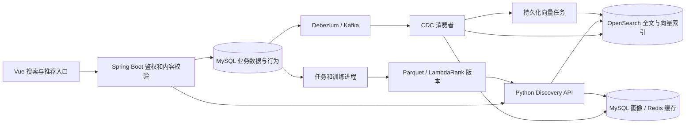

# 搜索与推荐系统实施与验收

恢复点：`8fbb1277ba26f7c00608671874f9c233f3069bad`，标签 `backup/pre-search-recommendation-2026-10-14`。本项目不实施广告。

## 已确认的交付范围

1. 统一检索球员、球队、比赛、新闻、帖子；中英文与别名、联想、关键词高亮、类型/球队/赛季/日期筛选、稳定分页、正确跳转。
2. 新闻和社区的“为你推荐”、同类详情推荐、首页 6 条混合推荐、关闭个性化、清除偏好和可撤销的不感兴趣。
3. Spring Boot 作为对外鉴权与业务校验入口；独立 Python Discovery API、消费者、训练进程；OpenSearch 全文/向量混合检索、Kafka KRaft、Debezium MySQL CDC、Redis 在线特征、Parquet 离线样本。
4. 新闻保留近 90 天、至多 10,000 条未收藏普通资讯；收藏内容与赛事不参与自动清理；独立 publishedAt。
5. 真实曝光（至少 50% 可见持续 1 秒）、点击、可见停留、业务事务中的点赞/收藏事件；eventId 幂等、requestId 归因、服务时刻特征快照。历史收藏仅初始化兴趣，不能伪造曝光。
6. 关注、内容相似、ItemCF、热度、新内容五路召回；最多 300 候选、100 精排、20 返回；多样性、负反馈、最近已读降权与真实推荐理由。
7. 可解释规则基线及首期 LightGBM LambdaRank 训练/评估/推理。门槛：14 天、10,000 曝光、500 正反馈、100 用户；数据不足继续基线。24 小时标签窗口、按时间分组切分、无未来特征泄漏；影子运行、5/20/50% 用户固定分桶、版本回滚。
8. 首次快照与增量/删除同步、消费幂等、向量版本校验、索引别名重建与回滚、失败重试与任务状态。公共结果不泄露用户特征。
9. Java 有界数据库降级、Redis 故障降级、账号隔离、删除前校验、后台状态与运维入口、容器部署说明及实际验收。

## 结构与边界



浏览器仅请求 Java 的 `/api/discovery/*`。Java 从登录态取得用户 ID；Python 的 `/internal/*` 使用独立内部令牌。Python 返回的分数、召回通道和特征仅保存在服务端请求快照，公共响应经过 Java 重新查询和裁剪，只保留可追踪的策略版本。每次返回再次检查删除和负反馈，数据库里的最新标题优先于索引副本。检索网络调用在事务外，最后的 JPA 内容读取、JDBC 校验和请求快照写入共用一个短事务，避免混用 JPA/JDBC 时申请第二条连接导致并发饥饿。

RAG 原有入口、检索库、重排器和问答逻辑保持独立。Discovery 与 RAG 只可共用只读模型权重目录。`richinfoai/ritrieve_zh_v1` 实际输出 **1792 维**，不能按其 BERT 隐藏层的 1024 维创建索引。

## 数据与检索

- `TYPE:业务主键` 是统一标识；比赛的 `MATCH:id` 与外部 `nbaGameId` 分离。详情路由保留 `recordId`，没有官方比赛 ID 时使用 `/api/match-records/id/{id}`。
- 别名来自实体中英文名、球队缩写、常见球员昵称和 `discovery_entity_aliases`。中文采用 CJK 分析，英文支持前缀联想。正文中的实体用于球队筛选和内容召回；别名更新会重投影新闻、帖子和比赛。
- 全文检索 BM25 与语义检索通过 RRF 融合；向量未就绪、编码器忙碌或单路超时可降为全文检索，并返回 `degraded`。所有检索都先应用类型、球队、赛季和日期过滤。日期以北京时间解释，结束日期包含当天；赛季目前主要用于比赛记录。
- 首次请求冻结排序结果，Redis 保存 10 分钟。游标绑定用户、偏好版本、场景、筛选、查询和页大小；跨账号、过期或修改筛选后返回 410，刷新后重新检索。单个搜索快照最多 250 个融合结果；推荐最多保存 5 页。
- 候选排序只读取 OpenSearch 的 ID 和 doc values，避免每次解码包含 1792 维向量的完整 `_source`。最终显示仍由 Java 查询业务库。
- 相同的索引查询、公开文档片段和内容向量平均值使用最多 256 条、1 秒 TTL 的进程缓存，并合并并发未命中请求。用户画像、个性化最终排序、鉴权和 Java 业务校验不进入该共享缓存。

迁移文件 `V20261014_01__discovery_data_foundation.sql` 增加新闻发布时间及 Discovery 表：偏好、画像、反馈、请求快照、行为、消费幂等记录、实体别名、索引状态、向量任务、控制状态、运维任务和模型注册表。旧新闻发布时间由已有业务时间回填；新导入优先来源发布时间，无有效来源时间时标记 `INGESTED`。

新闻清理统一由 `NewsRetentionService` 执行，导入和手工新增共用策略，默认每天北京时间 03:15 补偿清理。只清理超过 90 天或超过 10,000 条上限的未收藏普通资讯。收藏、赛事类别、官方比赛标识及 LIVE/SCHEDULED 记录受到保护。清理和收藏入口锁定同一新闻行，避免清理与新增收藏竞争；清理同时删除失效浏览历史。

## 推荐与学习

首页返回 6 条 NEWS/POST 混合内容，新闻、社区和对应详情分别限制同类。关注、内容向量、ItemCF、热度、探索每路最多召回 100；去重后 300 粗排、100 精排、每页最多 20。一次模型推理覆盖冻结的候选快照，翻页不重算。每页尽量限制同作者 2 条、同球队 5 条，数据不足才放宽；为新内容留约 10% 位置。解释取自实际命中的召回或排序信号。

初始规则分数为兴趣 0.30、内容相似 0.25、新鲜度 0.15、热度 0.15、关注 0.10、质量 0.05、ItemCF 0.10，再扣除重复曝光和最近已读。它是待真实反馈校准的业务基线，不代表训练得到的权重。历史收藏只能初始化兴趣，不能生成曝光或负样本。

前端曝光需要卡片至少 50% 可见且连续 1 秒；隐藏页面取消计时。详情 READ 只累计可见停留，达到 15 秒计有效阅读。客户端只能上报 IMPRESSION、CLICK、READ；点赞和收藏事件由对应业务事务写入。Java 校验 requestId 的所属用户、实际返回的内容与位置、24 小时时间窗口及阅读前有效点击。`eventId` 和请求/内容/事件类型双重幂等，换 eventId 重放同次曝光也不重复计数。

关闭个性化会停止该用户兴趣学习；清除偏好删除画像和负反馈并递增版本，不删除关注/收藏。清除时间之前的请求不能继续提交行为，旧消息也不能重建被清除的画像。浏览器切换账号时清空归因与请求，旧账号响应不能写回新账号界面。

训练仅使用真实曝光，窗口完成后按 24 小时内最大反馈构造 0/1/2/3 标签。特征取服务时刻快照，按请求和时间划分训练、验证、测试集，保留 Parquet 和模型校验和。门槛为跨度 14 天、10,000 次曝光、500 次正反馈、100 名用户；不足时记录 `INSUFFICIENT_DATA` 并保持基线。验证集和测试集均优于基线才能成为候选。管理员先开启影子运行，成功后依次 5%、20%、50% 固定用户分桶，支持回滚；不会因为定时训练而自动切换流量。

验收中的合成训练数据只验证实际 LightGBM 训练、Parquet、加载、影子运行和回滚。测试模型在完成后标为 `TEST_ONLY`，恢复原策略，不能据此宣称真实用户收益。

## 同步与恢复

Debezium 首次快照后持续读取 MySQL ROW/FULL binlog，覆盖五类内容、直接 Python 翻译写入、事件和别名。CDC 内容消息只是失效通知；消费者在每个业务键的数据库锁内读取当前业务行，再用单调版本写索引，因此重复、延迟和乱序旧消息不会覆盖最新业务数据。完成后才提交 Kafka 位点。

向量任务保存在 MySQL，失败退避重试。写向量时原子校验内容 hash 和删除标记；旧文本编码结果不能覆盖新文本。别名缓存不一致时先刷新实体再校验。文本更新无需等待向量完成便可被全文搜索。

重建使用新索引和双写，扫描完成后原子切换别名；保留上一代并持续更新，以支持回滚。重建失败不切换在线别名。任务中断标为失败，管理员可重试；任务支持取消。初期保留两代在线镜像，旧的多余代际需运维确认后清理。

OpenSearch/Python 不可用时，Java 每类型最多读取最近 500 条业务数据，过滤后最多保留 100 条结果，返回 `database-fallback-v1`。降级检索只保证有界基本匹配，不能等价替代完整别名/语义检索。Redis 故障时个性化退回通用排序，分页不可延续时要求刷新。模型校验或预测失败回退规则基线。

## 接口

| 方法与路径 | 用途 |
| --- | --- |
| GET `/api/discovery/search` | `q, types, team, season, dateFrom, dateTo, mode, limit, cursor` |
| GET `/api/discovery/suggest` | 同一检索体系的轻量联想 |
| GET `/api/discovery/recommendations` | `scene, itemKey, limit, cursor` |
| POST `/api/discovery/events` | `{events:[{eventId,requestId,itemKey,eventType,position,dwellMs,occurredAt}]}` |
| POST `/api/discovery/feedback` | `{itemKey,active}`；`false` 撤销不感兴趣 |
| GET/PUT `/api/discovery/preferences` | 读取或保存 `{personalized}` |
| DELETE `/api/discovery/preferences/history` | 清除已学偏好与负反馈 |
| GET `/api/admin/discovery/status`、`/jobs` | 管理员查看状态、模型、任务 |
| POST `/api/admin/discovery/jobs` | `SNAPSHOT, REINDEX, ITEMCF, TRAIN, PUBLISH, ROLLBACK_INDEX, ROLLBACK_MODEL` |
| POST `/api/admin/discovery/jobs/{id}/cancel` | 取消排队中或运行中的任务 |

`PUBLISH` 请求包含 `version` 和 `traffic`（0/5/20/50）。后台“数据同步”页面提供相同任务入口。所有管理接口要求 ADMIN，普通用户返回 403，未登录检索返回 401。

## 本地隔离部署

当前验证栈固定使用独立数据库，避免启动生产同步任务：

| 服务 | 本地端口 | 说明 |
| --- | --- | --- |
| MySQL | 13306 | `nba_discovery_test`，持久卷，ROW/FULL binlog |
| Redis | 16379 | 应用 DB 0，Discovery DB 2 |
| OpenSearch | 19200 | 单节点 2.19.2，1792 维 Lucene HNSW |
| Kafka | 19092 | 3.9.1 KRaft |
| Debezium Connect | 18083 | 3.1.2.Final |
| Java / Python API | 18080 / 19001 | Java 为公共鉴权入口 |
| Vite | 15173 | 代理到隔离 Java 服务 |

从仓库根目录执行（PowerShell）：

```powershell
Copy-Item deploy/discovery/.env.example deploy/discovery/.env.local
# 编辑 .env.local，分别设置随机数据库密码和内部令牌。
docker compose --env-file deploy/discovery/.env.local -f deploy/discovery/compose.yml up -d mysql redis opensearch kafka connect
cd backend
.\mvnw.cmd compile
.\mvnw.cmd dependency:build-classpath '-Dmdep.outputFile=scripts/runtime/discovery/classpath.txt'
cd ..
```

全新空库需要先建立本项目已有的 JPA 业务表；`start-local.ps1 -Role bootstrap` 仅用于这一步，跳过 Flyway。确认启动完成后停止该测试 Java 进程，再用 `-Role java` 正常启动并执行迁移。已有业务库不能使用 bootstrap。启动脚本会检查数据库名及 13306 端口，且禁用初始化抓取、自动同步和 RAG 预热。

Python 需要 `backend/scripts/venv312`，安装 `requirements-discovery.txt`，并备好指定 embedding 模型。主机模式依次运行：

```powershell
.\deploy\discovery\start-local.ps1 -Role api
.\deploy\discovery\start-local.ps1 -Role cdc
.\deploy\discovery\start-local.ps1 -Role jobs
.\deploy\discovery\start-local.ps1 -Role embeddings
.\deploy\discovery\start-local.ps1 -Role frontend
```

日志与 PID 在 `backend/scripts/runtime/discovery/`。注册连接器前把 `.env.local` 变量加载到进程环境，执行 `python -m discovery_app.register_connector`；主机默认访问 Connect 18083，连接器在容器内访问 `mysql:3306`。只注册已建好表的库。通过 `/connectors/nba-discovery/status` 检查 RUNNING 和任务状态。

容器模式使用 `docker compose ... --profile app up -d --build api cdc-worker jobs-worker embedding-worker`，与主机 Python 模式二选一。模型和训练产物各有持久卷；首次启动需要模型下载或挂载已有只读权重。容器内部注册连接器需设置 `DISCOVERY_CONNECT_URL=http://connect:8083`。Compose 暴露的端口均绑定 127.0.0.1；它是开发验收配置，接入现有部署时需要将数据库、内部网络和模型路径改为实际环境配置。

Java 配置 `DISCOVERY_SERVER_URL`（主机模式也可用 `--app.discovery.server-url=...`）和与 Python 相同的 `DISCOVERY_INTERNAL_TOKEN`。不能把内部令牌放到 Vite 环境变量或浏览器代码。当前 `.env.local`、JWT、模型、日志、数据库和测试运行文件均被 Git 忽略。

制作可执行包时，先在 `frontend` 执行 `npm run build`，再在 `backend` 执行 `.\mvnw.cmd -Pdiscovery-package package`。产物为 `backend/target/nba-manager-discovery.jar`，使用独立文件名避免与本机原应用占用的默认 JAR 冲突。主机开发模式已验证；生产部署推荐使用独立 Discovery 容器和自己的 Python 依赖环境。

## 验收记录

- [x] Java 全量及后续针对修改的回归：124 个测试类、659 项报告，656 项通过、3 项因未配置原有迁移集成测试环境而跳过，零失败；新增鉴权、事件归因、时序、偏好清除、比赛数据可见性和真实查询测试。
- [x] 新闻保留策略：H2 和独立 MySQL 8.0 测试库均通过，覆盖时间边界、收藏、赛事保护与数量限制。
- [x] 前端原全量 41 文件/206 项通过；类型检查和生产构建通过。新增 1 项账号切换竞态测试，连同 4 项行为统计回归均通过。
- [x] Python 23 项检索/特征/训练/缓存测试通过；真实组件栈 10 项通过，包括真实合成模型训练和完整灰度回滚。
- [x] 原有数据同步脚本 10 项离线回归通过；Linux 容器内的 23 项检索/训练/缓存测试也通过。
- [x] 真实 CDC 首次导入、直接翻译更新、删除、重复/旧消息、向量 hash 校验、重建双写和回滚；暂停 Connect 和重启消费者后提交的数据已成功追赶。
- [x] Redis 中断仍返回内容，推荐标记降级；OpenSearch 中断时两类接口使用数据库降级，恢复后服务正常。
- [x] Docker 镜像成功构建，容器内依赖、MySQL、Redis 与 OpenSearch 连通性通过；挂载只读权重后的真实 1792 维编码及业务投影通过。
- [x] 模型就绪后的固定 19 组中英文名和别名查询：BM25 与混合检索 MRR@10/Recall@10 均为 1.0，均无降级；混合模式逐条核对实际策略为 `hybrid-rrf-v1`。该小样本只作为实体检索回归，不能代表真实语料总体质量。
- [x] 最终缓存版本的 20 次源表修改可搜索延迟 P95 为 2,428.7 ms；10 次业务收藏切换的特征消费延迟 P95 为 667.3 ms。这是独立链路探测，没有与 50 并发查询混合施压。
- [ ] 浏览器视觉与交互验收：用户已授权并表示修改保存设置，但工具再次返回“保存的权限或管理策略拒绝访问 127.0.0.1:15173”。没有以其他浏览器或自动化方式绕过该限制。
- [x] 10 万内容/50 并发端到端压测已执行，2,000 次请求均为 HTTP 200，无空结果或降级；测试行和临时索引已清理，别名恢复 `nba-discovery-initial`，合成模型已退出在线策略。
- [ ] 全部延迟目标达标：关键词与混合检索达到目标，联想和推荐尚未达到，见下表。
- [ ] 更大规模真实语料的人工相关性标注及线上收益验证；合成样本不替代这部分。

性能初始目标为联想 P95 ≤150 ms、关键词 ≤300 ms、混合检索/推荐 ≤500 ms、文本与特征延迟 P95 ≤30 秒。参考资源为 8 核 32 GB；实测主机为 Ryzen 5 5600H（6 核/12 线程）、约 16 GB 内存，Docker 配额为 12 个逻辑 CPU、8,248,766,464 字节内存，OpenSearch 堆 1 GB，不能视为参考硬件达标证明。单次故障探测中 Redis 关闭时搜索 98 ms、推荐 625 ms；OpenSearch 关闭时搜索 735 ms、推荐 584 ms。这些是单次故障响应时间，不是 P95。

| 端到端接口 | 实测 P50 / P95 / P99（ms） | P95 目标（ms） | 错误 / 降级 | 结果 |
| --- | --- | --- | --- | --- |
| 联想 | 171.6 / 421.2 / 444.6 | 150 | 0 / 0 | 未达标 |
| 关键词 | 189.2 / 257.7 / 296.0 | 300 | 0 / 0 | 达标 |
| 混合检索 | 251.6 / 382.5 / 480.6 | 500 | 0 / 0 | 达标 |
| 首页推荐 | 431.4 / 669.6 / 713.8 | 500 | 0 / 0 | 未达标 |

原始数值、测试覆盖、版本与限制保存在 [discovery-acceptance.json](discovery-acceptance.json)。这些结果证明当前隔离环境中的功能与可用性，不能宣称全部验收完成或生产性能已达标。

补充的小语料 50 并发诊断中，推荐延迟存在波动并出现了降级；因此上表单次 2,000 请求的成功不能替代持续稳定性结论。顺序执行推荐的采样显示时间分布在 Redis 往返、候选转换和排序等环节，尚不足以把剩余延迟单独归因于硬件。下一步需要在参考资源上进行多账号、冷查询及持续负载的性能验证。

复现测试：在 `backend/scripts` 下激活 `venv312` 后，设置 `$env:PYTHONPATH=(Get-Location).Path`，运行 `python -m pytest tests/test_discovery_learning.py tests/test_discovery_serving.py tests/test_discovery_query_cache.py`；真实栈测试另设 `$env:DISCOVERY_STACK_TEST='1'`，运行 `test_discovery_stack.py` 和 `test_discovery_operations.py`。先用 `tests/discovery_stack.py` 创建隔离样本，所有脚本要求 `nba_discovery_test:13306`。模型操作测试只运行于该独立库。

性能脚本 `tests/discovery_benchmark.py --count 100000 --concurrency 50 --requests 500` 经过公共 Java API；临时插入合成 SQL 行与包含实际 1792 维样本向量副本的独立索引，记录错误、空结果、降级比例和延迟分位数。使用 1 个验收账号、8 个固定查询，每类预热 16 次后测量 500 次；不能等同于 50 个不同画像用户和任意冷查询的混合负载。测试期间不生成曝光。脚本在 `finally` 中恢复别名并清理自己创建的行与索引。测试语料和重复向量的负载性质必须与性能结果一起说明。

## 版本与恢复

原版本已推送到公开仓库 `quanyechaTAT/NBAManager`：`main` 和备份标签的目标提交均为 `8fbb1277ba26f7c00608671874f9c233f3069bad`。实施分支为 `codex/discovery-system`；本次实现尚未推送。

如需查看原版，创建独立检出即可保留当前工作：

```powershell
git worktree add -b codex/restore-pre-discovery '../NBAManager-restore' backup/pre-search-recommendation-2026-10-14
```

Git 恢复代码不等于恢复业务数据库。此次验收只修改隔离测试库；正式部署前应按原有数据库备份流程保存业务数据。索引可从 MySQL 重建；在线索引/模型回滚使用管理员任务，不需要回滚源码。
