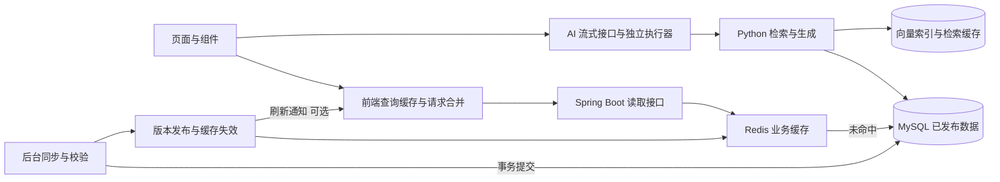
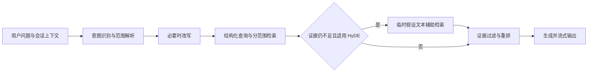

**NBAManager 性能优化设计与实施路线**

记录日期：2026-10-06，实施状态更新于 2026-10-07。参考提交：`7aa0413`。本文保留优化前的证据与分阶段设计；三轮代码优化及本地验证已实施，具体改动、汇总结果与实际部署测量的边界见 [第三轮与三轮汇总报告](<E:/Visual Studio Code/NBAManager/docs/performance-optimization-phase3-results.md>)。前两份实施报告已被汇总替代。以现有 Vue 3 / Spring Boot / MySQL / Redis / Python RAG 架构为基础，先改善用户可感知的等待、数据新鲜度和故障恢复，再根据压测结果调整容量。

**1. 当前证据与优先级判断**

本次对正在运行的本地后端进行只读检查，没有清空缓存、重启服务或制造并发负载。每个接口顺序请求 5 次，计时包含客户端和连接开销。下表是小样本观察，不能据此推算生产环境的 P95、最大吞吐量或真正的冷启动性能。

| 接口 | 第一次耗时 | 随后 4 次范围 | 响应体约大小 |
| --- | ---: | ---: | ---: |
| `/api/dashboard/overview` | 354.3 ms | 5.6–9.6 ms | 37.7 KiB |
| `/api/match-records` | 8.1 ms | 4.9–12.8 ms | 38.1 KiB |
| `/api/players?page=0&size=20` | 27.4 ms | 7.7–23.6 ms | 15.2 KiB |
| `/api/teams?page=0&size=30` | 9.9 ms | 8.2–9.6 ms | 14.1 KiB |

这四个接口均返回 200，响应包含 `Cache-Control: no-store, must-revalidate, no-cache, max-age=0`，未返回 ETag。以上大小按响应文本的 UTF-8 字节统计，不是浏览器抓包中的压缩传输大小。首页第一次耗时较长的原因尚未通过服务端追踪确定，不能归因于某一条 SQL。

已有 `frontend/dist` 的几个主要文件如下。gzip 大小是本地压缩估算，不代表实际网络传输；本次未重新构建，也未测量 LCP、INP、CLS。

| 文件类别 | 原始大小 | gzip 估算 | 加载判断 |
| --- | ---: | ---: | --- |
| Element Plus JS | 999.8 KiB | 325.6 KiB | 初始 HTML 包含 modulepreload |
| 入口 CSS | 443.9 KiB | 61.8 KiB | 初始 HTML 引用 |
| 入口 JS | 94.2 KiB | 36.3 KiB | 初始 HTML 引用 |
| 球员列表页面 JS | 295.2 KiB | 98.1 KiB | 路由按需加载 |
| 比赛详情页面 JS | 136.8 KiB | 43.7 KiB | 路由按需加载 |
| ECharts JS | 513.4 KiB | 171.6 KiB | 不在初始 HTML 的直接加载清单中 |

源代码中确认的改进点：

- [main.ts](<E:/Visual Studio Code/NBAManager/frontend/src/main.ts>) 全局安装 Element Plus 并引入全部样式；这是首屏资源优化的明确入口。
- [request.ts](<E:/Visual Studio Code/NBAManager/frontend/src/utils/request.ts>) 普通 Axios 请求默认超时为 20 分钟；故障时用户容易一直等待。401 和 403 目前都清理登录状态，也会造成无权限操作后的体验问题。
- [MatchDetailView.vue](<E:/Visual Studio Code/NBAManager/frontend/src/views/MatchDetailView.vue>) 为查找单场比赛拉取全部比赛记录；部分重型子组件静态导入，评论在页面初始化时请求。
- [DashboardService.java](<E:/Visual Studio Code/NBAManager/backend/src/main/java/com/nbamanager/service/DashboardService.java>) 存在全量读取后排序、筛选、在 Java 中分页的路径；应先改查询形态。
- [RedisConfig.java](<E:/Visual Studio Code/NBAManager/backend/src/main/java/com/nbamanager/config/RedisConfig.java>) 默认 TTL 为 30 分钟，比赛相关缓存继承默认值，未按直播、待开赛、完赛划分期限。
- [useDashboardCache.ts](<E:/Visual Studio Code/NBAManager/frontend/src/composables/useDashboardCache.ts>) 已有 sessionStorage 缓存，但跨组件的请求去重使用布尔标记，无法让所有调用方共享同一个 Promise 和结果。
- [ReplayTimelinePanel.vue](<E:/Visual Studio Code/NBAManager/frontend/src/components/game-intelligence/ReplayTimelinePanel.vue>) 对全部筛选结果执行 `v-for`；长回放需要测量 DOM 数量和滚动耗时，作为虚拟列表候选。

已有能力应继续保留：路由懒加载、ECharts 按需组件导入、比赛信息流共享请求、同步中心的串行轮询及取消、Redis 故障回退、AI 与回放等任务的独立执行器、RAG 检索证据约束，以及启动脚本复用已有 jar 的逻辑。不能把这些能力重复列为“尚未实现”。

判断：本地热请求已经较快，第一阶段应减少首屏资源和无效工作，建立正确的缓存更新机制。数据库冷查询、AI 阶段耗时和同步争抢资源需要进一步测量。

**2. 用户体验目标与验收口径**

用户需要感知到的是页面尽快出现、点击有回应、返回页面无需重新等待、比分可信、AI 能持续输出、后台同步不拖慢前台。

| 场景 | 建议目标 | 验证方法 |
| --- | --- | --- |
| 页面首次访问 | LCP ≤ 2.5 s、INP ≤ 200 ms、CLS ≤ 0.1 | 真实用户按移动端/桌面端分别看 P75；实验室测试辅助定位 |
| 首屏资源 | 对比同一页面的实际初始资源图，压缩 JS 减少至少 25% 作为首轮目标 | 相同构建参数、缓存清空、网络条件和登录状态 |
| 返回已访问页面 | 有可用缓存时立即显示主体，只在对应区域显示刷新状态 | 路由往返、弱网、单接口失败测试 |
| 普通读取 API | 固定硬件、固定数据、50 并发下 P95 ≤ 300 ms 作为待校准目标 | 单独报告冷缓存、热缓存、同步并行、Redis 不可用场景 |
| AI 回答 | 分别降低检索耗时和首个有效文本耗时 | 记录阶段耗时、首文本 P50/P95、完成时间、取消后残留任务 |
| 直播比分 | 展示真实更新时间，过期时标明延迟 | 测量来源更新 → 入库 → 缓存 → 浏览器的完整延迟 |
| 回放与列表 | 长列表点击、搜索、跳转和滚动仍流畅 | 浏览器性能追踪，关注长任务、DOM 数量、定位正确率 |

上述资源与 API 数字是实施后的初始验收目标，不是已经取得的结果；需依据部署硬件和实际网络调整。Core Web Vitals 的阈值及 P75 口径来自 [web.dev 官方说明](https://web.dev/articles/vitals)。发送“正在检索”或心跳不等于 AI 已经开始回答，应另行记录首个有效文本时间。

**3. 推荐架构与模块边界**

保持当前部署结构，在现有模块内集中管理查询、缓存和发布规则。



静态文件的 HTTP 缓存是一条独立路径，交给浏览器及部署时的反向代理处理；不是每个请求都经过图中的全部层次。

建议建立三个职责明确的内部入口，名称仅作设计示例：

- 前端 `QueryCache`：封装 key、共享 Promise、缓存容量、保鲜时间、取消、账号作用域、刷新和失败保留旧值。组件只订阅数据、状态并触发刷新。
- 后端 `MatchReadService`：封装单场、近期赛程、分页历史、状态契约、来源时间和比赛缓存规则，返回轻量 DTO。
- 后端 `DataPublicationService`：封装“同步校验成功后发布数据版本、失效关联缓存、更新 RAG 索引版本”的时序，避免散落在每个控制器中。

RAG 则沿用现有规划、证据解析、检索、生成边界，把各阶段的缓存与耗时预算集中在对应模块。只有出现清晰的容量或故障隔离需求，再考虑进一步拆分服务。

**4. 缓存的作用、层次与正确性**

缓存保存的是以前计算或读取过的结果。例如用户第一次打开球队排名，需要读取数据库并构造响应；下一次访问相同赛季和范围时，可以复用结果。缓存能减少等待和重复计算，但不能让尚未同步的数据变成最新数据。

| 层次 | 保存什么 | 对用户的作用 | 更新方式 |
| --- | --- | --- | --- |
| 浏览器 HTTP 缓存 | 带内容 hash 的 JS/CSS、图片、可验证的公共响应 | 再次访问少下载 | 新 hash URL；ETag 验证 |
| 前端内存查询缓存 | 当前会话的列表、详情、请求 Promise | 切页立即显示，多个组件共享一次请求 | TTL、写操作失效、版本变化、容量淘汰 |
| sessionStorage | 小型、低敏感度的公共页面快照 | 刷新页面后仍可先显示已有数据 | 有效期与源数据版本；不存大型回放、聊天全文 |
| Redis | 多个后端请求共享的公开查询 DTO、聚合结果 | 少查库、少重复聚合 | 提交后主动失效，TTL 兜底 |
| Python 进程内缓存 | 向量、检索结果、外部查询结果 | 降低重复检索成本 | 有界 LRU/TTL，模型和索引版本变化失效 |

前端缓存和 Redis 解决的问题不同：Redis 减少服务端工作，前端缓存还能省掉请求、网络等待和部分重复渲染。第一轮不额外加入通用 Java 进程内缓存，以控制一致性复杂度。

“缓存有效期”称为 TTL。例如 60 秒表示该缓存条目在这段时间内可以按规则复用；“主动失效”表示刚刚同步、修改或删除了数据，就立即让相关旧条目不再使用，而不是等待 60 秒。

“先显示缓存、后台更新”适用于排名、历史记录等允许短暂延迟的页面。用户先看到完整页面，刷新成功后局部替换；失败时保留旧数据并标注更新时间。这与 HTTP 的 [stale-while-revalidate 思路](https://developer.mozilla.org/en-US/docs/Web/HTTP/Reference/Headers/Cache-Control#stale-while-revalidate)一致，但业务缓存的状态、期限和数据时间要由应用自己管理。

**4.1 按业务制定有效期**

以下是建议起始参数，实际配置必须结合数据源更新频率、请求量和新鲜度目标调整。Redis TTL、浏览器复用和前端轮询期限是不同概念。

| 数据 | 建议服务端 TTL | 建议前端行为 | 主动更新触发 |
| --- | --- | --- | --- |
| 直播比分、实时比赛状态 | 2–5 秒 | 页面可见时每 5–10 秒刷新，或订阅已有推送；恢复可见时验证 | 有新比分或状态入库 |
| 待开赛赛程 | 通常 5 分钟；临近开赛 30–60 秒 | 通常 1–5 分钟验证；临近开赛更频繁 | 开赛时间、球队或状态变化 |
| 刚结束比赛 | 1–5 分钟 | 短期继续验证，等待数据修订 | 官方完赛确认、技术统计修订 |
| 已稳定的历史比赛、回放、技术统计 | 6–24 小时 | 快速复用，按版本验证 | 补录、纠错、翻译或分析版本变化 |
| 首页聚合信息 | 30–60 秒 | 立即显示快照，比分独立更新 | 排名、资讯、帖子等相关数据发布 |
| 球员分页列表 | 60–120 秒 | 相同筛选和页码共享缓存 | 球员和赛季数据发布 |
| 球员详情、球队排名 | 5–15 分钟 | 先显示缓存、后台验证 | 球员、排名数据发布 |
| 公共帖子列表 | 15–60 秒 | 发帖、删除后及时失效 | 发帖、删除及列表相关内容变化 |
| 点赞、收藏、权限、个人记录 | 优先短期内存缓存或不缓存 | 按账号隔离，操作后立即更新 | 用户操作、登录切换、权限变化 |
| 带 hash 的静态 JS/CSS | HTTP 缓存 1 年 | 同 URL 复用 | 发布时换 URL，保留旧资源供旧页面使用 |

直播的刷新间隔短，不代表比分一定只延迟几秒。如果上游每 30 秒更新，应用每 5 秒请求仍只能读到那份旧结果。必须记录 `dataUpdatedAt`（数据时间）、`fetchedAt`（本次获取时间）、`sourceVersion`（来源版本）等信息，不能把“刚从 Redis 读出”的时间当成“比分刚更新”的时间。

首页混合了排名、资讯与比分，整体缓存不能承担直播的新鲜度要求。保持 `/dashboard/overview` 的轻量聚合和容错能力，直播比分由独立的信息流更新。

待开赛比分仍须为空或 `--`，不能用旧比分或 0:0 伪造。缓存优化必须保留当前状态与事实校验契约。

**4.2 缓存键与账号隔离**

缓存 key 必须表达真正影响结果的条件，不能只用“问题文本”或“页面名称”。建议结构：

```text
nba:{schemaVersion}:{module}:{scope}:{dataGeneration}:{normalizedParameters}

示例：
nba:v4:match:0012600004:g18:detail
nba:v4:players:2025-26:g7:team=NYK:sort=ppg-desc:page=0:size=20
nba:v4:rankings:2025-26:g7:conference=east
rag:retrieve:{embeddingModelRevision}:{indexGeneration}:{scopeHash}:{queryHash}
```

统一分页边界、日期、赛季和排序编码，限制 key 数量和条目大小。个人查询增加用户作用域，退出或切换账号时清除对应数据并取消旧请求，防止旧账号的迟到响应写入新账号缓存。不在 key 或日志中保存原始登录令牌。

两队交锋 key 是否可以交换球队顺序，需要看响应语义。如果顺序决定展示方向或主客场解释，就必须保留方向。

**4.3 写入、同步与失效时序**

单实例阶段：数据库事务提交成功后，失效单场详情、相关赛程、球队交锋、排名等受到影响的缓存。失败或回滚不能发布“新版本”。前端本地写操作同步失效相关查询，例如发帖后刷新帖子列表，而不是清空全站缓存。

并发下还存在一个容易忽略的竞态：请求 A 读到旧数据；同步 B 提交并删除缓存；A 随后又把旧结果写回。热点比赛和批量同步建议使用版本化 key：请求 A 只能写入旧版本的 key，新读取使用新版本，旧 key 等待过期。版本获取和数据读取需要一致的发布契约，不能在加载完成后把旧数据标记为新版本。

进一步需要可靠的跨进程发布时，在同一数据库事务写入数据版本和 outbox 事件，后台重试 Redis 失效及索引刷新，消费者按版本幂等处理。第一阶段先做好提交后失效、日志和有限 TTL，避免为了简单本地部署引入不必要的分布式组件。

前端收到旧数据时不能不断重置其“新鲜起点”。多层缓存使用原始数据时间和剩余有效期，防止服务端缓存 30 分钟、前端再缓存 5 分钟导致陈旧窗口继续延长。

**4.4 缓存失效与故障保护**

- 热门缓存刚过期时，多人同时访问容易都去查库。按 key 合并回源；同一进程共享一次加载，多实例需要短租约或其他有界协调。锁超时和异常必须释放，不能用全局锁串行所有读取。
- `@Cacheable` 并不默认保证同 key 只执行一次；`sync=true` 的能力取决于缓存提供方，不能直接当成跨实例锁使用。[Spring 官方缓存说明](https://docs.spring.io/spring-framework/reference/integration/cache/annotations.html)
- 排名、历史数据可设软过期与硬过期：软过期后显示旧值并更新，硬过期后必须重新获取或明确标注暂不可用。直播缓存的过期容忍度应更短。
- TTL 加少量随机抖动，分批预热热门数据，避免所有缓存同一时刻失效。
- 对格式错误、越界参数在缓存前验证；确实不存在的公开 ID 可以极短期缓存空结果。数据库、上游错误和数据尚未同步不能伪装成“永久不存在”。
- 保留 Redis 故障回退，并加入短超时、失败熔断和回源限流，防止每次请求等待当前的 3 秒 Redis 超时后又压向数据库。具体超时值由部署网络测量确定。
- Redis 写入或失效失败时记录告警；恢复后先处理积压失效事件或更新缓存命名空间版本，再恢复正常读取。直播与个人权限不应使用来源时间不明的旧值。
- 对缓存设置容量上限、条目数量与体积限制，监测淘汰和热点 key。专用缓存实例可以选择 LRU/LFU 等策略；若 Redis 同时承载锁、任务协调等状态，应将可淘汰缓存与这些状态隔离。使用不同逻辑库并不能提供独立的内存淘汰边界。[Redis 官方淘汰说明](https://redis.io/docs/latest/develop/reference/eviction/)

**5. 前端加载、渲染和交互优化**

资源加载：Element Plus 改为按需组件与样式导入，完整保留中文 locale 和全局服务类组件的可用性；逐页确认弹窗、通知、表单与日期组件。保留已有路由懒加载与 ECharts 按需导入，检查 `manualChunks` 是否使原本可按需加载的依赖合并成过大的初始 chunk。支持方式参考 [Element Plus 官方指引](https://element-plus.org/en-US/guide/quickstart.html)。

比赛详情按当前标签加载回放、投篮图、聊天室及评论数据和重型组件代码；可采用异步组件、首次进入挂载、合理保留状态。返回标签时复用已读取结果。`router.isReady()` 的初始化顺序是已有白屏问题修复的一部分，应保留。

列表渲染：优先改成服务端分页。回放、长评论列表等测量到大量 DOM 的区域再引入虚拟列表，只渲染视口附近条目；30 支球队这类小列表无需复杂化。回放必须使用稳定事件 ID，将筛选后的事件映射为索引，滚动到该索引并等待渲染完成后再定位，保留现有点击跳转修复。Vue 的优化依据见 [官方性能指南](https://vuejs.org/guide/best-practices/performance)。

大型不变数组可按测量结果使用浅响应式和整体替换，避免重复创建对象及深层监听。搜索输入防抖约 200–300 ms，取消旧请求，只接受当前查询序号的结果。筛选计算缓存，图表复用实例、只更新必要的数据，隐藏页面暂停动画，离开页面销毁实例与事件监听。

图片和样式：已有多处图片懒加载应保留。按实际显示尺寸选择球员头像规格，减少小卡片下载大图；图片及骨架固定宽高或比例，避免布局跳动。首屏重要图片优先加载，屏外图片延迟；审查重复全局 CSS 和大面积模糊/阴影的绘制成本。低性能设备与系统“减少动态效果”偏好下适当减少动画。

交互反馈：有缓存时显示完整内容和局部刷新提示；没有缓存时使用尺寸稳定的骨架。单个模块失败不阻塞整页，保留已有首页部分失败能力。点赞、收藏等简单操作可先更新界面，失败则回滚；发帖、同步和复杂写入仍按服务端确认状态展示。403 显示权限提示并保留登录，401 再进入认证失效流程。

**6. 请求管理与后端读取接口**

建立共享查询缓存，多个组件请求同一 key 时共享 Promise 和结果，而不是由一个布尔值让其他调用方直接跳过。沿用现有 `useMatchFeed` 的共享机制，统一新鲜度、可见性和错误状态。

超时按请求类型设置：普通公开查询起始可设 8–15 秒，创建同步任务约 5–10 秒，轮询约 10–15 秒；大查询先改异步或分页。AI 流单独设置连接、首次进度、首次文本、空闲及总时间预算，不能用普通接口超时一刀切。用户离开页面或取消提问时，取消没有其他订阅者需要的请求。

只对适合重试的幂等读取进行有限次数退避重试，加入抖动并尊重 `Retry-After`；认证错误、无权限和业务校验失败不自动重试。写操作依赖业务幂等键和结果查询，不靠重复提交实现恢复。

读取 API 的建议改动：

| 场景 | 改动 | 作用 |
| --- | --- | --- |
| 比赛详情基础数据 | 新增按 `nbaGameId` 读取的轻量接口，复用已有仓库 `findByNbaGameId` | 避免下载全部比赛后查找一条 |
| 首页赛程、顶部比赛条 | 按日期/近期范围返回轻量 DTO，与分页历史分开 | 请求和数据量不随历史积累增长 |
| 历史比赛 | 日期/球队/赛季服务端筛选、稳定排序与分页 | 减少数据库加载和浏览器处理 |
| 个人收藏 | 直接返回个人收藏的分页结果或批量 ID 查询 | 避免先下载全部球员、球队或帖子再筛选 |
| 得分榜 | DTO 投影、数据库排序和分页 | 避免 Java 内全量读取与切片 |
| 回放 | 首次按需加载，直播使用增量游标；完赛快照按版本复用 | 少重复传输相同事件 |

兼容旧接口逐步迁移调用方，先保留响应状态与比分契约。通用列表限制最大 page size；低价值的大字段不进入首页 DTO。

**7. 数据库与服务端资源**

优先把 `DashboardService` 的全量读取改为聚合查询与小型 DTO：计数交给数据库，Top 9 使用限制条数的查询，分页榜单在数据库执行。筛选条件要保留当前赛季、已验证数据、缺失值和来源质量规则，不能为加速改变数据含义。

部分球员仓库已有 EntityGraph / JOIN FETCH，不能笼统断言全站存在 N+1。对首页等其他读取用 SQL 计数和追踪验证是否发生逐个球队加载，再选择投影或批量关联加载。首页聚合已经使用 RAG 状态快照，不应重新在请求中阻塞等待模型服务。

项目已有球队、日期、赛季、球员名称和任务状态等索引。候选优化包括单场 gameId 查找、球队加日期的历史读取、稳定分页排序、同步任务按状态和更新时间筛选，但须先检查实际数据库索引与执行计划，避免重复建索引。含 `OR` 的主客队查询和 `%keyword%` 搜索需要按实际扫描量评估；普通名称索引不会自动解决任意子串检索。数据规模确有需要时再考虑前缀、别名或搜索索引。

验证采用符合本机 MySQL 版本的 `EXPLAIN`，必要时在可控环境使用 `EXPLAIN ANALYZE`，检查扫描行数、排序和索引选择；实际执行型分析不要直接对高负载线上大查询使用。[MySQL 官方执行计划文档](https://dev.mysql.com/doc/refman/8.4/en/explain.html)

当前已有 HTTP 并发保护、Tomcat 线程限制、Hikari 连接池以及独立任务执行器。增加线程并不能让 20 个数据库连接完成更多同时执行的 SQL，还可能增加等待。通过数据库连接等待、CPU、队列长度、拒绝数、线程占用测量后调参，并给同步/AI/普通请求留出隔离预算。事务保持短，不在事务中等待外部数据源、模型或长时间网络调用；同一 JPA 事务/EntityManager 不跨线程并行使用。

**8. 数据同步与前台隔离**

沿用当前同步作业、步骤、取消和串行轮询模型。增量同步优先按日期、比赛 ID 和上次成功游标拉取，检查内容 hash，未变化的数据不重复写库和重建向量。批量读取、批量 upsert、有限分块事务，遵守外部来源限速，失败采用有界退避。

每个模块保持有限并发，同一比赛、同一数据模块避免重复作业。用户浏览高峰降低后台并发；暂停和取消通过协作式检查及时停止后续调用。进程重启后按持久化作业状态恢复或明确标记中断。

数据完成校验后再发布，不能清空现有可用数据再逐步灌入。批量替换采用暂存或版本快照，校验通过后切换版本；失败继续提供上一份已验证快照。RAG 索引构建成功后原子发布索引版本，查询不读取半成品，并据此失效检索缓存。

同步中心已具备 active 约 3 秒、idle 约 15 秒的串行轮询，先补充页面隐藏时暂停、恢复时立即验证，继续防止响应乱序。只有用户量与轮询成本确实需要时，再用 SSE 推送作业变化；进度推送丢失后仍须读取服务端最终状态。

**9. AI / RAG 的性能与回答质量**

沿用已经认可的路线，在每一步做预算和缓存，而不是对每个问题机械执行全部模型步骤。



现有实现已经对事实问题直接回答、历史比赛优先验证来源，并限制模型规划与 HyDE 的触发范围。性能优化应继续保持这些分支：事实查询不额外调用模型规划；已有充分证据不执行 HyDE；历史比赛按球队、日期、赛季和 gameId 匹配，不以模糊近似结果替代指定比赛。

“假设答案”只能作为临时检索提示，不能写入事实库或作为回答证据。当前代码已经把这段文本限制在检索过程内，应保留。可以缓存带明确类型标记的辅助检索结果，但不能使它进入可引用索引。

| AI 阶段 | 缓存或优化方法 | 正确性条件 |
| --- | --- | --- |
| 规划与改写 | 先用规则；合适的结果短期缓存 | key 包含已解析日期、实体、会话上下文摘要和规划版本 |
| 查询向量 | 缓存归一化文本的 embedding | 包含模型 revision、维度和处理版本；容量有界 |
| 检索 | 缓存证据集合和过滤结果 | 包含索引版本、数据版本、范围和检索配置 |
| 重排 | 限制候选数量，复用相同查询/候选组合的结果 | 不能略过范围校验，不损失关键证据 |
| 外部查询 | 继续利用已有搜索/历史来源缓存 | 按直播、新闻、历史结果分 TTL，保留数据时间 |
| 回答 | 后期只对完成、已验证、适合复用的公共单轮回答缓存 | key 覆盖模型/提示词、证据版本与比赛范围；不共享私人上下文 |

优先缓存 embedding 和检索，不先对所有回答做语义近似命中。“今天马刺和尼克斯”与“某年马刺和尼克斯”相似，但不应使用同一答案；拒答、失败、取消和未完成文本不写入长期成功缓存。

独立的 SQL、向量、外部来源分支只有在不影响来源优先级和范围校验时才有限并发；必须依赖范围解析或 HyDE 结果的操作仍保持顺序。历史比赛已有权威证据时，继续跳过没有必要的向量检索。限制检索候选与上下文长度，用评估集判断是否影响事实覆盖和追问质量。

记录 `scope/plan/sql/embedding/retrieve/rerank/search/first_text/generate` 分阶段耗时和缓存命中。外部模型延迟单独统计；预热常驻 embedding/reranker 服务，但不要让预热阻塞普通页面。模型未就绪时如实报告 readiness，并继续使用已验证的结构化或历史来源路径。

流式链路：浏览器 → 开发代理或生产代理 → Java → Python → 模型必须逐层转发、及时刷新；前端 SSE 文本解析继续处理拆包、合包、结束和错误。生产代理对流接口关闭响应缓冲，验证 `X-Accel-Buffering` 等控制是否实际生效，参考 [Nginx 官方文档](https://nginx.org/en/docs/http/ngx_http_proxy_module.html#proxy_buffering)。

前端积累小片段约 30–50 ms 后批量更新，减少每 token 触发组件和 Markdown 重渲染；结束时立即刷新剩余内容，保留现有安全渲染。用户取消应传递到下游模型、检索和网络任务，不只关闭聊天气泡；流中断显示明确状态，不把残缺回答当成成功记录。

深入追问基于本次实际证据生成，复用规划与实体范围，优先使用受约束模板或一次有预算的生成，不增加多个串行模型请求。回归集同时检查耗时、历史范围匹配、来源有效性和追问可回答率。

**10. HTTP 缓存、压缩、部署与启动**

| 响应类别 | 建议 HTTP 策略 | 说明 |
| --- | --- | --- |
| 带 hash 的构建 JS/CSS | `public, max-age=31536000, immutable` | 文件内容变化必须换 URL |
| HTML 入口 | `no-cache` + ETag | 每次验证，避免入口长期指向旧构建 |
| 已稳定的公共图片 | 带版本 URL 长缓存；无版本 URL 有限 TTL + 验证 | 上传头像改变内容后换 URL 或版本 |
| 公共低频 API | 先采用可验证响应，ETag 对应真实数据版本 | 鉴权、敏感字段和代理规则核对后再按白名单开放共享缓存 |
| 个人信息、权限、私有会话、同步命令 | 保持 `no-store`，或经专门设计的私有短缓存 | 用户数据不进入公共共享缓存 |
| SSE 流 | `no-cache, no-transform`，禁止响应缓冲 | 不当成普通可缓存 JSON |

`no-cache` 允许保存响应，但再次使用前要验证；`no-store` 禁止保存。ETag 未变化时返回 304，省去响应体下载。ETag 最好直接由数据版本与响应参数形成，若每次仍跑完整 SQL、序列化全文后才算 hash，只减少传输而没有解决后端计算。[MDN HTTP 缓存说明](https://developer.mozilla.org/en-US/docs/Web/HTTP/Guides/Caching)

当前 Java 已对静态文件启用压缩，JSON 压缩被有意关闭；配置注释记录了此前吞吐权衡。部署到真实网络后，再在反向代理评估大 JSON 和静态资源的 gzip/Brotli，比较传输收益与 CPU 成本，避免把本地网络结论直接推广到公网。SSE 单独验证输出间隔和代理行为，不套用普通响应压缩/缓冲策略。

生产环境提供已构建静态文件，Vite 开发服务器只服务开发。发布保留前一个版本的 hash 资源一段时间，避免旧页面跳转时加载不存在的 chunk。限制大型上传，必要时异步处理图片规格；后台日志分级、轮转，避免大量同步日志写入抢占磁盘。

本地启动继续复用已有 jar 和依赖；启动与构建分开，显示服务 readiness。若增加“代码改动后是否需要重建”的判断，应基于可靠指纹，不能把日志、输出文件等变化当作需要重建后端。RAG 模型常驻并预热，首屏不等待其全部加载完成。

**11. 测量、回归和实施顺序**

前端记录首屏资源大小、LCP/INP/CLS、路由与请求耗时、缓存命中、长任务和前端异常。后端记录按路由归类的 P50/P95/P99、数据库查询耗时/次数/连接等待、Redis 命中与错误、线程池和队列。AI 增加各阶段及首文本耗时。通过请求 ID 关联 Java、Python 和同步作业，避免将用户 ID、原始问题或 token 作为高基数指标标签。

| 阶段 | 工作范围 | 验收条件 |
| --- | --- | --- |
| P0：建立基线 | 真实浏览器性能追踪、冷/热接口、AI 分阶段耗时；固定测试数据和硬件 | 得到可复现报告，不用 5 次 localhost GET 推算容量 |
| P1：可感知的快速收益 | Element Plus 按需；详情按 gameId；标签按需；请求预算、取消、去重；403 体验 | 初始资源变小、普通请求故障及时结束、详情不拉全历史、关键交互不退化 |
| P1：缓存一致性 | 状态区分 TTL；原始数据时间；提交后失效；前端共享查询；热点回源合并 | 同步和写入后不持续展示旧状态，切换账号无串数据，回源并发有界 |
| P2：数据库和后台资源 | DTO/数据库分页、按执行计划补索引、增量同步、发布与任务预算 | 冷查询与同步期间 P95 改善，数据库等待和内存不恶化 |
| P2：AI 和重型界面 | embedding/检索缓存、阶段预算、长回放虚拟列表、流文本批量渲染 | 首文本耗时改善，取消及时释放资源，历史范围与事件跳转正确 |
| P3：部署与容量完善 | 静态/HTTP 缓存、代理压缩和流验证、可靠失效事件、多实例评估 | 实际网络下达标，发布无旧 chunk 失效、故障恢复可验证 |

每个阶段分成小批次，复用现有测试并针对关键契约补充必要验证。不能用前端体积下降抵消缓存错误，或用 AI 速度提升抵消事实质量下降。

重点场景：首次/重复访问、弱网、返回已访问详情、快速切换筛选、退出后换账号、同 key 突发读取、Redis 故障与恢复、同步提交时并发读取、比赛从待开赛到直播再到完赛、历史赛后修正、长回放点击定位、AI 首文本与取消、索引切换期间检索。

压测分开记录热缓存、冷缓存和真实混合访问。冷缓存测试使用隔离命名空间或测试实例，不清空当前服务数据。模型和数据源故障测试优先在可控环境模拟。比较相同数据规模、相同构建、相同硬件和网络，至少报告吞吐、P95、错误率、CPU/内存及数据正确性，不只看平均值。

缓存策略、前端查询层和新 API 设置独立开关，旧 API 在迁移期保留；索引迁移用版本化 SQL 管理。出现失效风暴或旧值问题时，可单独旁路相关缓存并降低后台并发。每轮确认结果后再扩大范围，最终以用户操作和数据正确性验收。
